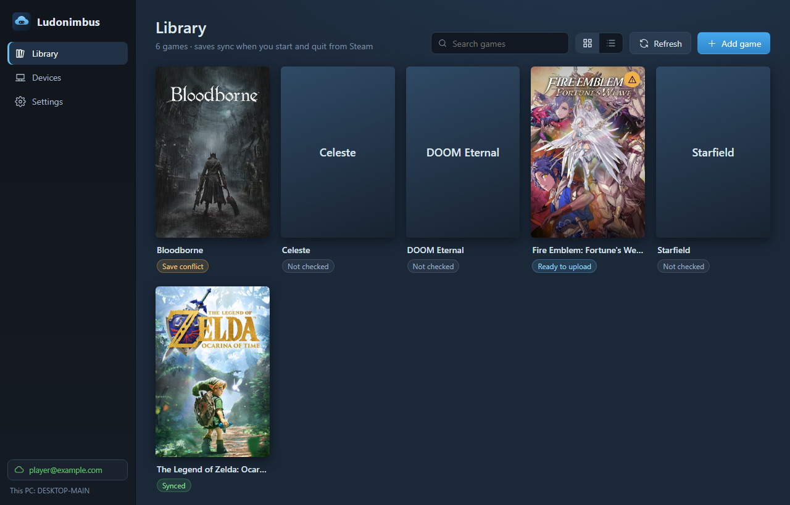
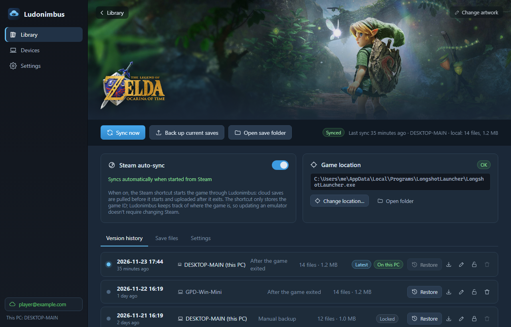
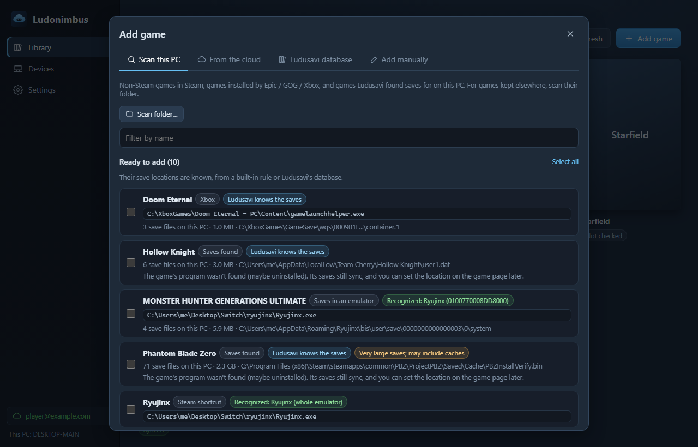

  

<h1 align="center">Ludonimbus</h1>

  <b>Steam Cloud for the games Steam doesn't sync.</b> 
  Emulators, recompiled games, ports and other non-Steam games: saves go to your own cloud, and every version is kept.

  
  
  

  <a href="https://github.com/Shupian0510/Ludonimbus/releases/latest"><b>Download</b></a>
  &nbsp;·&nbsp;
  <a href="https://shupian0510.github.io/Ludonimbus/en/">Documentation</a>
  &nbsp;·&nbsp;
  <a href="README.zh-CN.md">简体中文</a>
  &nbsp;·&nbsp;
  <a href="https://github.com/Shupian0510/Ludonimbus/issues">Report a problem</a>

  

## What it does

Steam Cloud only covers games bought on Steam. Anything else you add to Steam keeps its saves on one PC, and they're gone when you reinstall, move the game, update the emulator or switch PCs.

Ludonimbus gives those games the same experience:

  <b>Press Play in Steam</b> &nbsp;→&nbsp; newer saves are pulled &nbsp;→&nbsp; you play &nbsp;→&nbsp; new saves are uploaded as a new version

   
  Cloud save status right next to Play on the Steam game page (Steam shown in Chinese)

## Highlights

- 🔄 **Hands-free**: start games from Steam as usual; syncing happens before launch and after exit.
- 🕘 **Every version kept**: restore, export or lock any version. Conflicts keep both sides.
- ☁️ **Your own cloud**: Google Drive, NAS / WebDAV, S3, Quark or any folder. No third-party servers.
- 🔍 **Finds games for you**: scans Steam shortcuts, Epic / GOG / Xbox, emulators and thousands of PC games.
- 🎮 **Feels like part of Steam**: status and version history on the game page, one-click *Add to Steam* with SteamGridDB artwork.
- 🧳 **Nothing gets lost**: reinstalling, moving a game, updating an emulator or going offline doesn't break sync.
- 🏆 **More than saves**: play time added up over your PCs, Steam screenshots on every PC, and achievements for emulators and recomps with Steam's own popup.
- 📦 **Back up whole games**: keep a game's files in your cloud and install it again on any PC, from Ludonimbus or the Steam game page.

<table>
  <tr>
    <td width="50%"></td>
    <td width="50%"></td>
  </tr>
  <tr>
    <td align="center">Auto-sync and version history for each game</td>
    <td align="center">Scan this PC and add games in bulk</td>
  </tr>
</table>

## Get started

Needs **Windows 10 / 11 (64-bit)** with **Steam** installed.

1. **Install**: download `Ludonimbus_x.y.z_x64-setup.exe` from [Releases](https://github.com/Shupian0510/Ludonimbus/releases/latest). No admin rights needed; updates are one click.
2. **Connect a cloud**: the first-run guide walks you through it.
3. **Add games**: *Add game → Scan this PC*, then tick the games you want.
4. **Turn on Steam auto-sync** on each game's page (or click *Add to Steam…*), then play from Steam as usual.

Windows or your browser warns about the installer?

The installer isn't code-signed yet.

- **"Isn't commonly downloaded"**: in Edge, "…" → Keep → Show more → Keep anyway; in Chrome, Keep.
- **"Windows protected your PC"**: More info → Run anyway.

📖 [Quick start](https://shupian0510.github.io/Ludonimbus/en/guide/quick-start.html) · [Non-Steam cloud saves](https://shupian0510.github.io/Ludonimbus/en/non-steam-cloud-saves/) · [Emulator saves](https://shupian0510.github.io/Ludonimbus/en/emulator-cloud-saves/) · [Recompiled game saves](https://shupian0510.github.io/Ludonimbus/en/recompiled-game-saves/) · [Google Drive sync](https://shupian0510.github.io/Ludonimbus/en/google-drive-save-sync/) · [Compared with Ludusavi and OpenSave](https://shupian0510.github.io/Ludonimbus/en/comparison/)

## Supported

<table>
  <tr>
    <td nowrap><b>Clouds</b></td>
    <td>Google Drive · Quark (experimental) · WebDAV: NAS, Jianguoyun, Nextcloud, OpenList / AList (for Baidu Netdisk, Aliyun Drive…) · S3: MinIO, Aliyun OSS, Tencent COS, Cloudflare R2 · any folder (OneDrive, NAS share, USB drive)</td>
  </tr>
  <tr>
    <td nowrap><b>Emulators</b></td>
    <td>Game by game: Dolphin, Cemu, Azahar / Citra / Lime3DS, RPCS3, shadPS4, PPSSPP, Vita3K, RetroArch, Ryujinx Whole emulator: Eden / Citron / Sudachi / Suyu / yuzu, PCSX2, DuckStation, Xenia</td>
  </tr>
  <tr>
    <td nowrap><b>Recomps&nbsp;&amp;&nbsp;ports</b></td>
    <td>140+, such as Ship of Harkinian, Zelda 64: Recompiled, Unleashed Recompiled, OpenGOAL and sm64ex</td>
  </tr>
  <tr>
    <td nowrap><b>PC games</b></td>
    <td>Thousands, from <a href="https://github.com/mtkennerly/ludusavi">Ludusavi</a>'s save database. For anything else, "play and find" shows the folders a game just wrote to.</td>
  </tr>
</table>

Full lists: [clouds](https://shupian0510.github.io/Ludonimbus/en/clouds/) · [emulators](https://shupian0510.github.io/Ludonimbus/en/supported/emulators.html) · [recomps](https://shupian0510.github.io/Ludonimbus/en/supported/recomps.html) · [PC games](https://shupian0510.github.io/Ludonimbus/en/supported/pc-games.html)

## Privacy

- Saves only travel between your PC and your cloud. There are no developer servers, and nothing is collected.
- Google Drive access is limited to files Ludonimbus created; WebDAV / S3 passwords stay in the Windows Credential Manager.
- The status in Steam is optional. It runs on the open-source [Millennium](https://github.com/SteamClientHomebrew/Millennium) plugin framework (not a Valve component), downloaded from its official releases only when you click *Install*.

Details: [Privacy policy](https://shupian0510.github.io/Ludonimbus/en/privacy.html)

## FAQ

<b>Does it sync if I don't start the game from Steam?</b>

It uploads after the game exits (while Ludonimbus is in the tray), but it can't pull before launch. Start from Steam to get the newest saves first.

<b>I played on two PCs and the saves conflict.</b>

Before the game starts, you choose the cloud's saves or this PC's. Both stay in the version history, so you can switch back any time.

<b>Can I use Baidu Netdisk or Aliyun Drive?</b>

Yes, through [OpenList](https://github.com/OpenListTeam/OpenList) / AList over WebDAV. One-click Baidu Netdisk sign-in is ready and waiting for Baidu's review. Quark connects with a QR code (experimental).

<b>Does it support macOS or Linux?</b>

Only Windows for now.

More: [FAQ and troubleshooting](https://shupian0510.github.io/Ludonimbus/en/reference/faq.html)

## Roadmap

- [x] Sync play time and Steam screenshots across PCs (0.6)
- [x] Version list inside Steam (0.6)
- [x] Back up the games themselves to the cloud (0.6)
- [x] Achievements (0.6)
- [ ] One-click Baidu Netdisk sign-in (waiting for Baidu's review)

## Contributing

[Issues](https://github.com/Shupian0510/Ludonimbus/issues) and pull requests are welcome, especially save rules for games ([`adapters/builtin.yaml`](adapters/builtin.yaml)) and emulators ([`adapters/emulators.yaml`](adapters/emulators.yaml)). Building from source: [`docs/development.md`](docs/development.md).

## Acknowledgements

[Ludusavi](https://github.com/mtkennerly/ludusavi) (save database, bundled) · [RecompLauncher](https://recomplauncher.com/) (recomp save locations) · [Millennium](https://github.com/SteamClientHomebrew/Millennium) (Steam plugin framework) · [Tauri](https://tauri.app/)

## Code signing policy

Free code signing provided by [SignPath.io](https://about.signpath.io/), certificate by [SignPath Foundation](https://signpath.org/).

- Only installers that GitHub Actions builds from this repository's public source code are signed, and the maintainer approves every release before it is signed.
- Committers and reviewers: [Shupian0510](https://github.com/Shupian0510)
- Approvers: [Shupian0510](https://github.com/Shupian0510)
- Privacy: Ludonimbus sends nothing to the developer. It connects only to the services you set up (your cloud storage, SteamGridDB with your own key) and to GitHub, to check for updates and to download Ludusavi's game database. See the [Privacy policy](https://shupian0510.github.io/Ludonimbus/en/privacy.html).
- The application to SignPath Foundation is in progress; installers are unsigned until it is approved.

## License

[MIT](LICENSE) © Shupian0510
