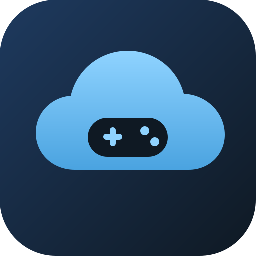

<p align="center">
  
</p>

<h1 align="center">Ludonimbus</h1>

<p align="center">
  <b>Steam Cloud for Non-Steam Games, Emulators and Recompiled Games</b><br>
  Open-source game save sync with version history and Steam integration, using your own cloud storage.
</p>

<p align="center">
  <a href="https://github.com/Shupian0510/Ludonimbus/releases/latest"></a>
  
  <a href="LICENSE"></a>
</p>

<p align="center">
  <a href="https://github.com/Shupian0510/Ludonimbus/releases/latest"><b>Download</b></a>
  &nbsp;·&nbsp;
  <a href="https://shupian0510.github.io/Ludonimbus/en/">Website</a>
  &nbsp;·&nbsp;
  <a href="README.zh-CN.md">简体中文</a>
  &nbsp;·&nbsp;
  <a href="https://github.com/Shupian0510/Ludonimbus/issues">Report a problem</a>
</p>

---

Steam Cloud only works for games bought in the Steam store. The emulators, recompiled games, ports and other games you add to Steam keep their saves on your PC only, so they are easy to lose when you reinstall a game, move it to another folder, update an emulator or switch PCs.

Ludonimbus is a free, open-source Steam Cloud alternative for these games: newer saves are pulled automatically before you start a game from Steam, new saves are uploaded after it exits, and every version is kept. Saves live in **your own** Google Drive, NAS, WebDAV / S3 storage or any folder, with no third-party servers.

Use cases: [cloud saves for non-Steam games](https://shupian0510.github.io/Ludonimbus/en/non-steam-cloud-saves/) · [emulator save sync](https://shupian0510.github.io/Ludonimbus/en/emulator-cloud-saves/) · [recompiled game saves](https://shupian0510.github.io/Ludonimbus/en/recompiled-game-saves/) · [syncing saves with Google Drive](https://shupian0510.github.io/Ludonimbus/en/google-drive-save-sync/) · [how it compares to Ludusavi and OpenSave](https://shupian0510.github.io/Ludonimbus/en/comparison/)

## Features

- **Works like Steam Cloud**: press Play in Steam as usual. Newer saves in the cloud are pulled before the game starts and new saves are uploaded after it exits. Steam still tracks your play time.
- **Status right inside Steam**: the play bar of a game's page shows "up to date", "uploading", "conflict" and so on, and you can sync with one click. Optional; Ludonimbus sets it up in one click.
- **Deleting a game doesn't lose its saves**: saves are tracked relative to the game folder. After reinstalling, moving the game or switching PCs, they come back on the first launch.
- **Emulator updates don't break sync**: a new version extracted into a new folder is found automatically; if a Steam shortcut is edited or recreated, Ludonimbus offers a one-click repair.
- **Version history**: every version records the time, device and trigger. Restore it, export it as a zip, lock it or add a note. Old versions are cleaned up automatically; manual backups are kept forever.
- **Conflicts keep both sides**: when two PCs both changed the saves, you choose which one to use, and the other stays in the version history.
- **Works offline**: if the cloud can't be reached, the game starts anyway. Saves are kept on the PC and uploaded once you're back online.
- **Add games without hunting for saves**: "Add game → Scan this PC" lists non-Steam games in Steam, games installed by Epic / GOG / Xbox, games with saves inside emulators, folders you point it at, and any of the thousands of PC games that already have saves on this PC, ready to tick and add in bulk. Games Steam Cloud already syncs are listed apart, so nothing is managed twice. For games it doesn't recognise, "play and find": start the game, save once, and Ludonimbus lists the folders that were just written to.
- **Finds where games are installed**: for games found only by their saves, Ludonimbus looks for the game program in the install folders of Epic, GOG, Xbox, EA, Ubisoft and other stores; if it can't, you can pick from those install folders directly.
- **One-click Add to Steam**: games that aren't in Steam (including Xbox app / PC Game Pass games) can be added with one click, or in bulk, and sync from their first launch. Cover, background, logo and icon can be set automatically or picked from SteamGridDB, or come from local images.
- **Your choice of cloud**: Google Drive (one-click sign-in), Quark (QR-code sign-in, experimental), a NAS such as Synology, Jianguoyun, Nextcloud, object storage such as Aliyun OSS / Tencent COS; Baidu Netdisk, Aliyun Drive and others through OpenList / AList. When you switch clouds, the history is copied over in one click.
- **Steam-style interface**: a grid / list library that uses the covers, banners and logos you set in Steam; games that aren't in Steam can have artwork too.
- **English and Chinese**: the interface follows the Windows display language and can be switched in Settings. A first-run guide helps you connect a cloud and start adding games.

## Download and install

**Requirements**: Windows 10 / 11 (64-bit) with Steam installed.

1. Download `Ludonimbus_x.y.z_x64-setup.exe` from [Releases](https://github.com/Shupian0510/Ludonimbus/releases/latest).
2. Run the installer. It installs for the current user and doesn't need administrator rights.
3. When a new version is out, Ludonimbus offers a one-click update.

> The installer isn't code-signed yet, so it may be stopped on the way:
>
> - **The browser says the file "isn't commonly downloaded"**: in Edge, hover over the download, click "…" → "Keep" → "Show more" → "Keep anyway"; in Chrome, click "Keep".
> - **Running it shows "Windows protected your PC" or "Unknown publisher"**: click "More info" → "Run anyway".

## Quick start

1. **Connect a cloud**: the first-run guide walks you through this; you can change it later in Settings → Cloud:
   - **Google Drive**: just sign in in your browser.
   - **Quark** (experimental): scan a QR code with the Quark app. The first time, the open-source OpenList (about 57 MB) is downloaded; the rest is automatic.
   - **WebDAV**: a NAS (Synology, QNAP…), Jianguoyun, Nextcloud, or [OpenList](https://github.com/OpenListTeam/OpenList) / AList (which can mount Baidu Netdisk, Aliyun Drive and others). Enter the address, user name and password, and click "Test connection" first.
   - **S3-compatible storage**: MinIO on a NAS, or Aliyun OSS, Tencent COS, Cloudflare R2.
   - **Folder**: a folder synced by the OneDrive / Google Drive desktop app, a NAS share, a USB drive.
2. **Add games**: "Add game → Scan this PC" lists the games it found. Tick the ones whose save location is known; for the others, click "Choose saves…" and follow the steps to find the save folder. For games kept elsewhere, click "Scan folder…".
3. **Turn on Steam auto-sync**: for games already in Steam, turn on "Steam auto-sync" on the game's page; for games that aren't, click "Add to Steam…". Changing Steam shortcuts requires closing Steam briefly; Ludonimbus closes and reopens it for you.
4. **Play as usual**: from now on, just start games from Steam.

When you close the window, Ludonimbus stays in the system tray. If you open a game directly instead of through Steam, it still backs up the saves after the game exits.

Step-by-step guides for every cloud and feature are in the [documentation](https://shupian0510.github.io/Ludonimbus/en/guide/quick-start.html).

## Cloud save status inside Steam

Open Settings → "Show cloud save status in Steam" and click "Install". The play bar of a game's Steam page then gets a cloud save status item, next to "Last played" and "Play time":

- It updates live while launching from Steam, while playing and while uploading after exit.
- Click the button on the right to sync now; click the status itself to open the game in Ludonimbus.
- It only shows for games Ludonimbus manages; regular Steam games are not affected.

This is built on [Millennium](https://github.com/SteamClientHomebrew/Millennium), an open-source plugin framework for the Steam client. If you don't have Millennium yet, Ludonimbus downloads the latest stable release from its official GitHub releases page, verifies it and installs it, the same steps the official installer takes. Millennium is not an official Valve component; the plugin can be removed in the same place at any time.

## Supported games

**Recomps and ports** (recognised by their program, 140+):

- Popular projects with checked save locations: Ship of Harkinian, 2 Ship 2 Harkinian, Ghostship, Starship, SpaghettiKart, sm64ex, sm64coopdx, Perfect Dark, Unleashed Recompiled, OpenGOAL (Jak 1–3), Super Mario Bros. Remastered, Longshot (Ocarina of Time), fefw recomp (Fire Emblem: Fortune's Weave), Lantern Engine (Bloodborne).
- The rest come from [RecompLauncher](https://recomplauncher.com/)'s game catalog: projects whose developers declared their save location, plus N64Recomp games such as Zelda 64: Recompiled, Banjo: Recompiled and Donkey Kong 64: Recompiled.
- Games installed with RecompLauncher are listed directly by "Scan this PC"; Steam shortcuts made by RecompLauncher are recognised too.

**Emulators**:

| Emulator | Platform | Sync mode |
|---|---|---|
| Dolphin | GameCube / Wii | Per game (GameCube needs GCI folder memory cards, Dolphin's default) |
| Cemu | Wii U | Per game; reads the MLC folder you set in Cemu |
| Azahar, Citra, Lime3DS | 3DS | Per game |
| RPCS3 | PS3 | Per game |
| shadPS4 | PS4 | Per game |
| PPSSPP | PSP | Per game |
| Vita3K | PS Vita | Per game |
| RetroArch | Multi-system | Per game (by game file name) |
| Ryujinx | Switch | Per game; on each PC finds the save of the current user profile, and creates it on a new PC if missing (Ryujinx must be closed) |
| Eden, Citron, Sudachi, Suyu, yuzu | Switch | Whole emulator (saves are tied to the local user profile, so syncing them separately wouldn't line up on another PC) |
| PCSX2 | PS2 | Whole emulator (memory cards are shared by all games) |
| DuckStation | PS1 | Whole emulator |
| Xenia | Xbox 360 | Whole emulator |

For "per game" emulators:

- "Scan this PC" lists every game that has saves inside the emulator (source "Saves in an emulator"), without needing a Steam shortcut first. When the game file can be found (Ryujinx's and Dolphin's game folders, Cemu's game list), adding it to Steam starts that game directly.
- When a Steam shortcut starts a game file (for example shortcuts made by Steam ROM Manager), Ludonimbus reads the game ID from the disc image, game folder or NSP / XCI and syncs only that game's saves.
- A shortcut that only opens the emulator syncs the saves of the whole emulator. For each emulator it's one or the other: the whole emulator, or game by game.

Both portable and installed versions are found; only saves are synced, never keys, firmware or caches.

**Other games**:

- Save locations for regular PC games come from [Ludusavi](https://github.com/mtkennerly/ludusavi)'s database, which covers thousands of games and is matched automatically when you scan this PC.
- For games that aren't in the database, pick from common locations, "play and find", or choose the save folder by hand.

Rules for [`adapters/builtin.yaml`](adapters/builtin.yaml) (games) and [`adapters/emulators.yaml`](adapters/emulators.yaml) (emulators) are welcome.

## How it works

```text
Steam "Play"
  ↓
ludonimbus-run: pull newer saves from your cloud
  ↓
start the game and wait until it and its launcher have fully exited
  ↓
upload the new saves as a new version
```

With auto-sync on, the Steam shortcut first starts `ludonimbus-run`, a small Ludonimbus program that syncs before and after the game; the shortcut's name, icon, artwork and play time stay the same. Each version is an append-only, immutable zip snapshot that records the device, the time and the previous version, so any sync can be undone.

## Privacy and security

- **Saves only travel between your PC and your cloud.** The developer has no servers and cannot collect any data.
- **Google Drive access is limited to files Ludonimbus created.** Saves are in a "Ludonimbus" folder in your Drive, which you can browse and download on the Drive website.
- **WebDAV / S3 passwords stay on your PC** in the Windows Credential Manager, never in the config file, and are removed when you disconnect.
- **The Quark sign-in stays on your PC**, inside the OpenList that Ludonimbus runs (it only listens on this PC); saves travel only between your PC and Quark, and the sign-in is removed when you disconnect.
- **SteamGridDB uses your own API key**: game names are sent to SteamGridDB only when you search for artwork, and the key is kept in the Windows Credential Manager. Without a key you can still use local images.
- **The Steam plugin only displays information**: it asks the Ludonimbus tray app for the status through a local interface that only listens on this PC and requires a token generated at every start. It never touches your cloud account.
- See the [Privacy policy](https://shupian0510.github.io/Ludonimbus/en/privacy.html).

## FAQ

<details>
<summary><b>Does it sync if I don't start the game from Steam?</b></summary>

It uploads, but it doesn't pull before launch. With Ludonimbus in the tray, it notices the game exiting and backs it up. To get the newest saves before you play, start the game from Steam.
</details>

<details>
<summary><b>I played on two PCs and the saves conflict. What do I do?</b></summary>

Before the game starts, a dialog asks whether to use the cloud's saves or this PC's. Both are kept in the version history, so even if you pick the wrong one you can restore the other at any time.
</details>

<details>
<summary><b>Can I use Baidu Netdisk, Aliyun Drive or Quark?</b></summary>

Quark connects in one click with a QR code (experimental); see the [documentation](https://shupian0510.github.io/Ludonimbus/en/clouds/quark.html). One-click Baidu Netdisk sign-in is ready and waiting for Baidu's open-platform review; it will be enabled in a new version once approved. Until then, and for Aliyun Drive (which has no official API for individual developers), connect through [OpenList](https://github.com/OpenListTeam/OpenList) / AList: mount your netdisk in OpenList first, then connect Ludonimbus to OpenList over WebDAV, with the folder inside the mounted netdisk. Speed and reliability depend on the netdisk and OpenList's driver. Jianguoyun has WebDAV built in and can be connected directly.
</details>

<details>
<summary><b>Do Xbox app (PC Game Pass) games work?</b></summary>

They can be added to Steam. An Xbox game's own program is protected by Windows and can't be started by other programs, so Ludonimbus starts it through `gamelaunchhelper.exe` in the game folder and uploads saves after the game itself exits. When picking a program by hand, choose `gamelaunchhelper.exe` in the `Content` folder too. Xbox games usually have Xbox cloud saves already; if Ludusavi's database knows where the saves are, Ludonimbus keeps another copy with version history.
</details>

<details>
<summary><b>Why does the scan say Steam Cloud already syncs some games?</b></summary>

Those games are installed in Steam right now and Steam Cloud already syncs them, so Ludonimbus doesn't need to. If you uninstall one from Steam and play it on another store instead, it shows up under "Ready to add".
</details>

<details>
<summary><b>What happens to my old saves when I switch clouds?</b></summary>

After you connect the new cloud, Settings asks whether to copy the saves from the old cloud. Copying keeps the full history and never changes the old cloud; if it's interrupted, click again and it picks up from what wasn't copied yet.
</details>

<details>
<summary><b>What should I do before uninstalling Ludonimbus?</b></summary>

Turn off "Steam auto-sync" on each game's page, and the Steam shortcuts go back to how they were. Your saves and versions stay in the cloud; reinstall Ludonimbus and connect the same cloud later to get them back.
</details>

<details>
<summary><b>Does it support macOS or Linux?</b></summary>

Only Windows for now.
</details>

More questions and troubleshooting: [FAQ and troubleshooting](https://shupian0510.github.io/Ludonimbus/en/reference/faq.html).

## Roadmap

- [x] Google Drive / synced folders, auto-sync, version history, conflict handling, auto-update
- [x] Cloud save status on the Steam game page, with one-click plugin install

**Next**

- [x] WebDAV (NAS, Jianguoyun, Nextcloud, OpenList), S3-compatible storage, one-click copy of saves when switching clouds
- [ ] One-click Baidu Netdisk sign-in (ready, waiting for Baidu's review)
- [x] Easier game adding: scan installed games and existing saves; step-by-step help to find the saves of unknown games
- [x] One-click Add to Steam for games that aren't in Steam, with cloud saves on and artwork from SteamGridDB
- [ ] Sync Steam screenshots and play time, so they survive switching PCs
- [x] More save rules for emulators and recomps: 19 emulators (most sync per game, including Ryujinx), 140+ recomps and ports
- [x] Scan games with saves inside emulators and add them one by one, even without Steam shortcuts
- [x] One-click Quark with a QR code (experimental)
- [x] English interface, a first-run guide, documentation in Chinese and English

**Later**

- [ ] Version list inside Steam, and turning auto-sync on or off without closing Steam
- [ ] Back up the games themselves to the cloud and "install from the cloud" in Steam
- [ ] Achievements

## Contributing

[Issues](https://github.com/Shupian0510/Ludonimbus/issues) and pull requests are welcome, especially new emulator / game save rules. Building from source and development notes: [`docs/development.md`](docs/development.md).

## Acknowledgements

- [Ludusavi](https://github.com/mtkennerly/ludusavi) (MIT): the save location database and lookup; the installer includes its official program.
- [RecompLauncher](https://recomplauncher.com/): save locations of recompiled games come from its game catalog.
- [Millennium](https://github.com/SteamClientHomebrew/Millennium) (MIT): the Steam client plugin framework. Ludonimbus doesn't bundle it; it's downloaded from the official releases page only when you click "Install".
- [Tauri](https://tauri.app/)

## License

[MIT](LICENSE) © Shupian0510
