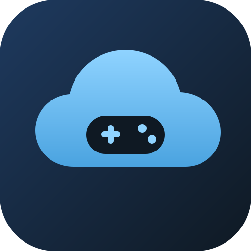
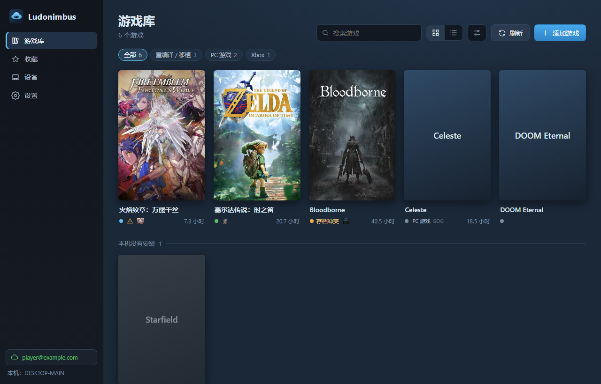
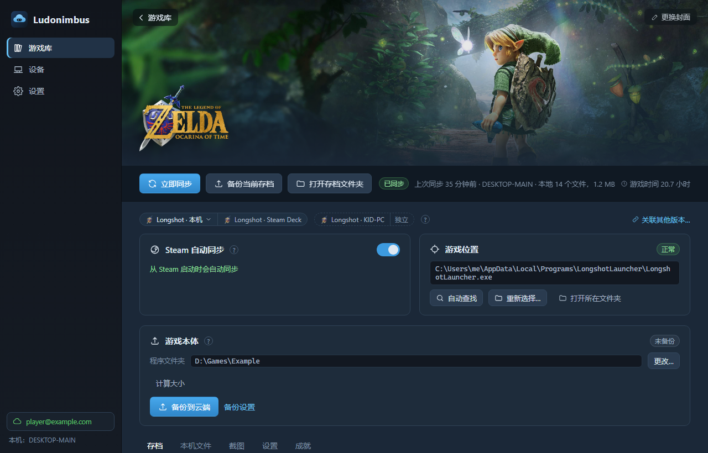
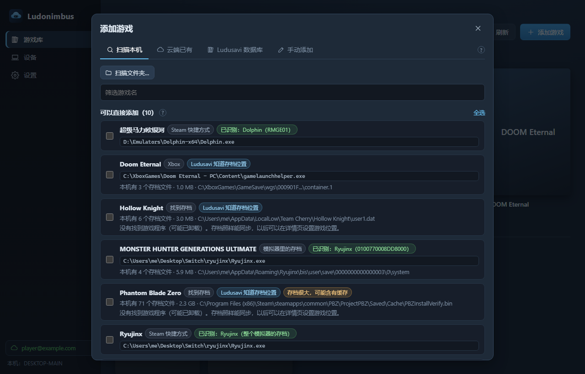

  

<h1 align="center">Ludonimbus</h1>

  <b>给 Steam 不同步的游戏补上云存档</b> 
  模拟器、重编译 / 移植游戏和其他非 Steam 游戏：存档放进你自己的云盘，每个版本都留着。

  
  
  

  <a href="https://github.com/Shupian0510/Ludonimbus/releases/latest"><b>下载</b></a>
  &nbsp;·&nbsp;
  <a href="https://shupian0510.github.io/Ludonimbus/">使用文档</a>
  &nbsp;·&nbsp;
  <a href="README.md">English</a>
  &nbsp;·&nbsp;
  <a href="https://github.com/Shupian0510/Ludonimbus/issues">反馈问题</a>

  

## 它做什么

Steam 云存档只管 Steam 商店里买的游戏。其他加进 Steam 的游戏，存档只留在本机：重装、换文件夹、更新模拟器或者换电脑时，很容易就丢了。

Ludonimbus 让这些游戏也用上同样的体验：

  <b>在 Steam 点「开始游戏」</b> &nbsp;→&nbsp; 拉取较新的存档 &nbsp;→&nbsp; 开玩 &nbsp;→&nbsp; 退出后上传为新版本

   
  Steam 游戏页「开始游戏」旁边直接显示云存档状态

## 亮点

- 🔄 **全自动**：照常从 Steam 启动游戏，启动前和退出后自动同步。
- 🕘 **每个版本都留着**：随时恢复、导出或锁定任意版本；存档冲突时两份都保留。
- ☁️ **用你自己的云盘**：Google Drive、NAS / WebDAV、S3、夸克网盘或任意文件夹，没有第三方服务器。
- 🔍 **自动找游戏**：扫描 Steam 快捷方式、Epic / GOG / Xbox、模拟器和上万款 PC 游戏。
- 🎮 **像 Steam 自带的一样**：游戏页显示同步状态；一键「加入 Steam」，自动配上 SteamGridDB 封面。
- 🧳 **怎么折腾都不丢**：重装、移动游戏、更新模拟器或者断网，同步都不会断。

<table>
  <tr>
    <td width="50%"></td>
    <td width="50%"></td>
  </tr>
  <tr>
    <td align="center">每个游戏的自动同步和版本历史</td>
    <td align="center">扫描本机，勾选后批量添加</td>
  </tr>
</table>

## 快速开始

需要 **Windows 10 / 11（64 位）**，并已安装 **Steam**。

1. **安装**：从 [Releases](https://github.com/Shupian0510/Ludonimbus/releases/latest) 下载 `Ludonimbus_x.y.z_x64-setup.exe`。不需要管理员权限，以后一键更新。
2. **连接云盘**：第一次打开时的引导会带你完成。
3. **添加游戏**：「添加游戏 → 扫描本机」，勾选想要的游戏。
4. **开启 Steam 自动同步**：在游戏详情页打开（不在 Steam 里的点「加入 Steam…」），之后照常从 Steam 玩。

下载或安装时被 Windows / 浏览器拦了？

安装包暂未进行代码签名。

- **「通常不会下载此文件」**：Edge 里点「…」→「保留」→「显示更多」→「仍然保留」；Chrome 里点「保留」。
- **「Windows 已保护你的电脑」**：点「更多信息」→「仍要运行」。

📖 [快速开始](https://shupian0510.github.io/Ludonimbus/guide/quick-start.html) · [非 Steam 游戏云存档](https://shupian0510.github.io/Ludonimbus/non-steam-cloud-saves/) · [模拟器存档同步](https://shupian0510.github.io/Ludonimbus/emulator-cloud-saves/) · [重编译游戏云存档](https://shupian0510.github.io/Ludonimbus/recompiled-game-saves/) · [用 Google Drive 同步存档](https://shupian0510.github.io/Ludonimbus/google-drive-save-sync/) · [和 Ludusavi、OpenSave 的对比](https://shupian0510.github.io/Ludonimbus/comparison/)

## 支持什么

<table>
  <tr>
    <td nowrap><b>云盘</b></td>
    <td>Google Drive · 夸克网盘（实验性）· WebDAV：NAS、坚果云、Nextcloud、OpenList / AList（可接百度网盘、阿里云盘等）· S3：MinIO、阿里云 OSS、腾讯云 COS、Cloudflare R2 · 任意文件夹（OneDrive、NAS 共享目录、移动硬盘）</td>
  </tr>
  <tr>
    <td nowrap><b>模拟器</b></td>
    <td>按游戏同步：Dolphin、Cemu、Azahar / Citra / Lime3DS、RPCS3、shadPS4、PPSSPP、Vita3K、RetroArch、Ryujinx 整个模拟器同步：Eden / Citron / Sudachi / Suyu / yuzu、PCSX2、DuckStation、Xenia</td>
  </tr>
  <tr>
    <td nowrap><b>重编译&nbsp;/&nbsp;移植</b></td>
    <td>140 多个，例如 Ship of Harkinian、Zelda 64: Recompiled、Unleashed Recompiled、OpenGOAL、sm64ex</td>
  </tr>
  <tr>
    <td nowrap><b>PC&nbsp;游戏</b></td>
    <td>上万款，存档位置来自 <a href="https://github.com/mtkennerly/ludusavi">Ludusavi</a> 的数据库。认不出的游戏可以「玩一下再找」，列出刚被写入的文件夹。</td>
  </tr>
</table>

完整列表：[云盘](https://shupian0510.github.io/Ludonimbus/clouds/) · [模拟器](https://shupian0510.github.io/Ludonimbus/supported/emulators.html) · [重编译游戏](https://shupian0510.github.io/Ludonimbus/supported/recomps.html) · [PC 游戏](https://shupian0510.github.io/Ludonimbus/supported/pc-games.html)

## 隐私

- 存档只在你的电脑和你的云盘之间传输。开发者没有服务器，也不收集任何数据。
- Google Drive 只能访问 Ludonimbus 自己创建的文件；WebDAV / S3 的密码只保存在本机的 Windows 凭据管理器里。
- Steam 里的状态显示是可选功能，基于开源插件框架 [Millennium](https://github.com/SteamClientHomebrew/Millennium)（不是 Valve 官方组件），只在你点「一键安装」时从它的官方发布页下载。

详见[隐私政策](https://shupian0510.github.io/Ludonimbus/privacy.html)

## 常见问题

<b>不从 Steam 启动游戏也能同步吗？</b>

Ludonimbus 在托盘里时，游戏退出后会自动上传，但没法在启动前拉取。想先拿到最新存档，请从 Steam 启动。

<b>两台电脑都玩过，存档冲突了怎么办？</b>

启动前会让你选用云端还是本机的那份。两份都留在版本历史里，选错了也能随时换回来。

<b>能用百度网盘、阿里云盘吗？</b>

可以，通过 [OpenList](https://github.com/OpenListTeam/OpenList) / AList 用 WebDAV 接入。百度网盘一键登录已经做好，正在等百度审核。夸克网盘可以扫码一键连接（实验性）。

<b>支持 macOS 或 Linux 吗？</b>

目前只支持 Windows。

更多见[常见问题与故障排查](https://shupian0510.github.io/Ludonimbus/reference/faq.html)

## 路线图

- [ ] 跨电脑同步游戏时间和 Steam 截图
- [ ] 在 Steam 里查看版本列表
- [ ] 把游戏本体备份到云盘
- [ ] 成就
- [ ] 百度网盘一键登录（等待百度审核）

## 参与开发

欢迎提交 [Issue](https://github.com/Shupian0510/Ludonimbus/issues) 和 Pull Request，尤其是游戏（[`adapters/builtin.yaml`](adapters/builtin.yaml)）和模拟器（[`adapters/emulators.yaml`](adapters/emulators.yaml)）的存档规则。从源码构建见 [`docs/development.md`](docs/development.md)。

## 致谢

[Ludusavi](https://github.com/mtkennerly/ludusavi)（存档数据库，随安装包附带）· [RecompLauncher](https://recomplauncher.com/)（重编译游戏的存档位置）· [Millennium](https://github.com/SteamClientHomebrew/Millennium)（Steam 插件框架）· [Tauri](https://tauri.app/)

## 代码签名政策（Code signing policy）

免费代码签名由 [SignPath.io](https://about.signpath.io/) 提供，证书由 [SignPath Foundation](https://signpath.org/) 颁发。

- 只有 GitHub Actions 从本仓库公开源码自动构建的安装包才会签名，每个版本签名前都由维护者手动批准。
- 提交者与审核者：[Shupian0510](https://github.com/Shupian0510)
- 签名批准者：[Shupian0510](https://github.com/Shupian0510)
- 隐私：Ludonimbus 不向开发者发送任何数据，只连接你自己设置的服务（你的云盘、用你自己 Key 的 SteamGridDB），以及 GitHub：检查更新、下载 Ludusavi 的游戏数据库。详见[隐私政策](https://shupian0510.github.io/Ludonimbus/privacy.html)。
- 目前正在向 SignPath Foundation 申请，通过之前的安装包没有签名。

## 许可

[MIT](LICENSE) © Shupian0510
