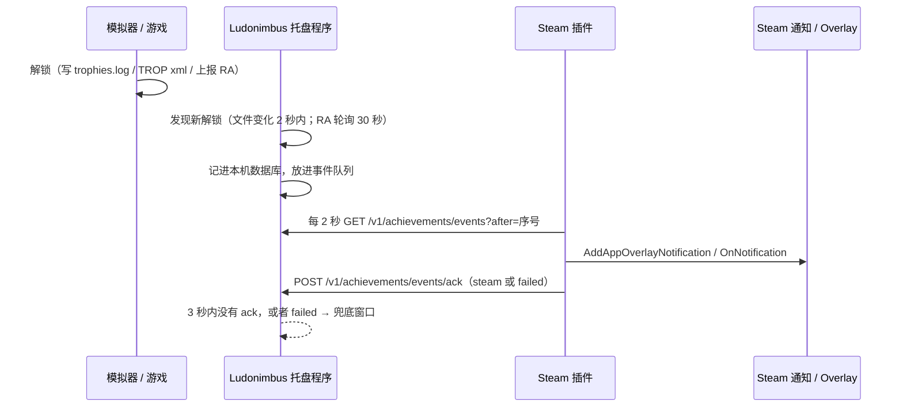

# Ludonimbus 成就方案（草案 v0.1 · 2026-11-23）

> **进度（2026-11-23）**
> - 调研完成。第 8 节的决定：弹窗由你装测试版验证；第一批做本地奖杯 + RetroAchievements（RA 先用文档样例测，真实账号以后再测）；Steam 弹窗默认开启并提示关掉模拟器自带的通知；Lantern 先显示编号和图标，检测到 shadPS4 解出的 `TROP.XML` 时自动用里面的名称。
> - **P0–P4 已实现**（分支 `claude/achievements-730281`）：core 模块 `crates/core/src/achievements/`、托盘程序的检测线程和事件队列 `app/src-tauri/src/achievements.rs`、兜底小窗口、本机接口、插件的 Steam 弹窗 `toast.ts` 和游戏页成就项 `achievements.ts`、应用里的「成就」标签和设置。自动测试和你这台电脑上的只读检查见 [testing-achievements.md](testing-achievements.md)。
> - **扩大覆盖面**（2026-11-24）：「Ludonimbus 自己维护成就库」的评估见 [plan-achievements-coverage.md](plan-achievements-coverage.md)：PS4 的官方名单可以用奖杯密钥从用户自己的游戏文件解出（已在 Bloodborne 上验证；Ludonimbus 不附带密钥，用 shadPS4 的 `TrophyKey` 或用户在设置里填的）；Switch 有社区规则库 TrophyNX 可用；重编译游戏用自己的存档规则库。
> - **待你实测**：按 [testing-achievements.md](testing-achievements.md)，重点是第 1 节（Steam 弹窗，桌面和游戏内）和 Lantern 的 `trophies.log` 格式。
> - 云端读写：2026-11-23 已合并 `main`（05dfbfc、9c1097d），成就记录和主会话的游戏时间一样走 `CloudProvider::files()` 返回的路径式 `Store`（Google Drive 也实现了 `Store`），成就这边没有再改 `cloud/` 下的文件。

> **背景**：给 Steam 里的非 Steam 游戏补上成就：记录、跨设备同步、在 Steam 游戏页显示、游戏中解锁时弹窗。对应 [plan-phase1.md](plan-phase1.md) 第 10 节的「成就」和第 9 节的「Steam 风格的通知」。和主会话的 0.6（截图、游戏时间、Steam 里的版本列表）、游戏本体云备份分开实现。
>
> | 部分 | 一句话 |
> |---|---|
> | 来源 | 第一批：RetroAchievements（Web API）+ PS 系本地奖杯（shadPS4 / Lantern、RPCS3） |
> | 存储 | 本机缓存 + 云端每台设备一个只追加的记录文件 `games/<key>/achievements/<设备>.json` |
> | Steam 显示 | 游戏页「开始游戏」栏加一项「成就 12 / 40」，点开是成就列表 |
> | 游戏内弹窗 | 直接调用 Steam 自己的成就通知（同样的弹窗和音效，游戏里显示在 Steam Overlay 上）；兜底是 Ludonimbus 的置顶透明窗口 |

---

## 0. 结论

1. **游戏内弹窗可行，而且能用 Steam 原生的成就弹窗。** Steam 前端（`steamui/sp.js`，本机 2026-11-11 的版本，changelist 11229305）把通知中心挂在全局的 `window.NotificationStore` 上：
   - `GetNotificationTargets()`：每种通知类型的配置。成就那一项带着反序列化用的 protobuf 类（`proto`）、Steam 的成就音效、开关设置 `achievement_notification_toast`，测试名是 `strTest: "Achievement"`；
   - `AddAppOverlayNotification(appid, id, 类型, 数据)`：把一条通知放进**某个正在运行的游戏的 Overlay** 队列；`GetAppsWithOverlayRunning()` 列出哪些游戏的 Overlay 在运行；
   - `OnNotification(id, 类型, 数据)`：Steam 客户端收到通知时走的入口（桌面右下角弹出；游戏运行时，游戏内的 Overlay 也会取这个队列）；
   - `TestAchievement(appid)`：Steam 自带的测试函数，就是用上面的办法造一条假的成就通知。

   Millennium 插件的前端和 `sp.js` 在同一个 JS 环境（SharedJSContext，插件现在用的 `MainWindowBrowserManager`、`g_PopupManager` 也在这里），所以插件可以照着 `TestAchievement` 的写法，把 Ludonimbus 的成就（名称、说明、图标、解锁时间）填进去，Steam 就会像真成就一样弹窗、放音效。弹窗渲染时用 `appid` 取游戏的名称和图标，非 Steam 快捷方式也有这些信息。

   这些都是没有文档的内部接口，Steam 更新后可能改名（应对见 4.5）。**静态分析的结论还要在真实 Steam 里验证**（8.1）。
2. **Steam 自己的成就区块不建议复用。** 游戏页和 Overlay 里的成就区块只在 `appDetails.achievements.nTotal > 0` 时显示，数据由 Steam 客户端（C++）提供。要显示就得伪造 Steam 的游戏详情数据，点进去还会打开 Steam 社区的成就页（快捷方式没有）。改为插件自己画，借用 Steam 的类名保持原生样式，和现在的云存档状态项一样。
3. **第一批来源**：RetroAchievements（需要你的 RA 用户名和 Web API Key）和 PS 系本地奖杯（shadPS4 / Lantern、RPCS3）。Xenia、Vita3K、基于存档的规则成就放第二批；GOG / Epic / Xbox 不做；不支持破解补丁生成的成就文件。

---

## 1. 数据来源

### 1.1 总表

| 来源 | 读什么 | 定义（名称、说明、图标） | 解锁记录 | 需要用户提供 | 批次 |
|---|---|---|---|---|---|
| RetroAchievements | RA Web API | ✓（图标是 RA 的网址） | ✓ 含时间、硬核模式 | RA 用户名 + Web API Key | 第一批 |
| shadPS4 | `user/trophy/<NPWR…>/Xml/TROP*.XML` + `user/home/<用户>/trophy/<NPWR…>.xml` | ✓（前提是用户在 shadPS4 里配置过奖杯密钥） | ✓ Unix 秒 | 无 | 第一批 |
| Lantern Engine（Bloodborne） | 存档文件夹里的 `trophies.log` + 游戏的 `trophy00.trp` | ✓（2026-11-24 起有奖杯密钥时解密游戏自己的 `trophy00.trp`，见 1.3；没有密钥时只有编号和图标） | ✓ | 奖杯密钥（可选） | 第一批 |
| RPCS3 | `dev_hdd0/home/00000001/trophy/<NPWR…>/` 下的 `TROPCONF.SFM`、`TROPUSR.DAT`、`TROPnnn.PNG` | ✓ | ✓ | 无 | 第一批 |
| PS4 移植 / 重编译（2026-11-24） | 移植版文件夹里原版游戏的 `trophy00.trp`（解密）+ `trophies.log` / `unlocked.txt` / `progress_user*.txt` / `trophies.dat` / 运行日志 | ✓ | ✓ | 无 | 已实现，见 [plan-achievements-coverage.md](plan-achievements-coverage.md) |
| 存档规则（TrophyNX 格式，2026-11-24） | Switch 游戏（模拟器、重编译）和 Cemu 上的 BotW 的存档 | ✓（英文） | ✓ | 无 | 已实现，同上 |
| Vita3K | `ux0/user/00/trophy/…`（PS3 系的 TROPUSR 格式，待核实） | | | 无 | 第二批 |
| Xenia Canary | 档案里的 `<TitleID>.gpd`（XDBF 格式） | ✓ | ✓ | 无 | 第二批 |
| 基于存档的规则成就 | 存档文件 | 规则文件里写 | 同步时判定 | 无 | 第二批 |
| GOG / Epic / Xbox | — | — | — | — | 不做，见 1.6 |
| Goldberg / CODEX 等破解补丁 | — | — | — | — | 不支持，见 1.8 |

### 1.2 RetroAchievements

**怎么上报**：RetroArch、DuckStation、PCSX2、PPSSPP、Dolphin 等内置 rcheevos 的模拟器，登录 RA 后自己判定、自己上报。Ludonimbus 不参与判定，也不调用模拟器用的 `dorequest.php` 接口，只**只读**公开的 Web API。

**用到的接口**（`https://retroachievements.org/API/API_*.php`，参数 `y` 是 Web API Key）：

| 接口 | 用途 |
|---|---|
| `API_GetUserProfile` | 设置里的「测试连接」，确认用户名和 Key |
| `API_GetUserRecentlyPlayedGames` | 关联游戏时列出你最近在 RA 上玩过的游戏，直接选 |
| `API_GetUserSummary` | 用 `LastGameID` 和 `RichPresenceMsgDate` 判断：游戏在运行但还没关联时，猜是哪个 RA 游戏，提示关联 |
| `API_GetGameInfoAndUserProgress` | 一个游戏的全部成就（标题、说明、分数、`BadgeName`、类型）和你的解锁时间（`DateEarned`、`DateEarnedHardcore`） |
| `API_GetUserRecentAchievements`（`m` 是分钟数） | 游戏运行时轮询，发现新解锁 |

图标：`https://media.retroachievements.org/Badge/<BadgeName>.png`（未解锁的加 `_lock`）。RA 返回的时间是 UTC 的 `YYYY-MM-DD HH:MM:SS`。RA 的用户名可以改，第一次查询后记下返回的 ULID，以后用 ULID 查。

**关联方式**：Ludonimbus 的游戏和 RA 游戏 ID 一对一。像 rcheevos 那样算 ROM 哈希太复杂（每种主机算法不同），不做；改为 ① 从「最近玩过」里选，② 手动填 ID，③ 游戏运行中自动提示（`LastGameID` 在最近几分钟内更新过）。

**轮询频率**：游戏运行时每 30 秒一次 `GetUserRecentAchievements`；游戏不运行时不轮询，只在打开成就页和游戏退出后刷新一次 `GetGameInfoAndUserProgress`。RA 没有公开具体的频率限制，这个频率下玩一小时约 120 个请求。

**使用条款**（RA 官网「Legal & Terms」。网站有机器人验证，自动程序打不开，条款原文从 RA 开源的网站代码 `RAWeb/resources/js/pages/terms.tsx` 读的）：
- 「Achievement Data」一节：成就的标题、说明和相关元数据**可以被第三方引用或重用**（原文举的例子是追踪网站、社区工具）。
- 同一节：成就的**触发逻辑**（判定条件，接口里的 `MemAddr`）归 RA 社区所有，不能重用或分发。Ludonimbus 不读也不存这部分。
- 「Copyright」一节：网站内容受版权保护，允许个人使用的复制。所以徽章图片只在本机缓存给自己看，不上传云盘，云端只存图片网址。
- RA 记录 API 使用日志。官方文档要求把 Web API Key 当密码保管：存在 Windows 凭据管理器（和云盘密码一样），不写进配置文件，也不交给 Steam 插件。
- 结论：只读、用用户自己的 Key、低频请求，符合条款。没有找到针对第三方 API 客户端的额外限制；正式发布前可以在 RA 的 Discord 打个招呼（可选）。

### 1.3 PS4：shadPS4 和 Lantern Engine

**shadPS4**（上游 2026-11 的 main，`src/core/libraries/np/np_trophy.cpp`）：
- 定义：第一次运行游戏时，把 `sce_sys/trophy/trophy00.trp` 解出到 `user/trophy/<NPWR…_00>/`：`Icons/`（`ICON0.PNG`、`TROP000.PNG`…）和 `Xml/`（`TROP.XML`，以及按语言的 `TROP_XX.XML`）。`.trp` 里的 XML 是加密的（`.ESFM`），**用户要自己在设置里填奖杯密钥**才能解出；图标不加密。
- 解锁记录：`user/home/<用户 id>/trophy/<NPWR…_00>.xml`，每个 `<trophy>` 带 `unlockstate="true"` 和 `timestamp="<Unix 秒>"`。
- `user` 文件夹：便携版在 `shadPS4.exe` 旁边，安装版在 `%APPDATA%\shadPS4`（和 `emulators.yaml` 的 `roots` 一致）。
- 游戏对应哪个 `NPWR`：游戏文件夹的 `sce_sys/npbind.dat` 里有（你的 Bloodborne 是 `NPWR05818_00`）；找不到时看 `user/trophy/` 下是否只有一个，否则让用户选。

**Lantern Engine**（你的 Bloodborne，0.9.43）基于 shadPS4，但奖杯是自己实现的：
- 按启动器里的说明，它在当前档案的存档文件夹里写 **`trophies.log`，每次解锁一行（id 和时间）**；游戏引擎的日志 `logs/last_session.log` 里会出现 `Runtime: trophy N unlocked`，启动器读这一行来弹它自己的奖杯通知。
- 图标：启动器解到 `%APPDATA%\Lantern Engine\trophy-icons\<哈希>\TROP000.PNG…`。Ludonimbus 也可以自己从 `trophy00.trp` 里取（PNG 不加密，文件头和条目表格式简单）。
- **名称**：Lantern 把名称内置在启动器里，不写到文件。**2026-11-24 起** Ludonimbus 用奖杯密钥解密游戏自己的 `sce_sys/trophy/trophy00.trp`。**Ludonimbus 不附带密钥**：先用 shadPS4 `config.toml` 里的 `TrophyKey`，其次用用户在「设置 → 成就 → PS4 奖杯密钥」里填的（只存在这台电脑的 `achievements\settings.json`，不上传；Lantern 没有类似设置）。没有密钥时只取图标，奖杯显示为「奖杯 N」。解密后得到官方名称、说明、等级和是否隐藏，按界面语言选 `TROP_XX`（简体中文是 `TROP_11`），图标也从这里取，都缓存在 `%APPDATA%\Ludonimbus\achievements\trophies\<NPWR>\`。游戏文件夹来自 Lantern 的 `settings.json`（`game_dir`）或 shadPS4 的 `installDirs`，用 `npbind.dat` 里的奖杯组编号对应。实现见 `crates/core/src/achievements/trp.rs`，评估见 [plan-achievements-coverage.md](plan-achievements-coverage.md)。
- 你这台电脑上还没有 `trophies.log`（还没解锁过奖杯），**具体的行格式要等你解锁一个奖杯后确认**。实现时两边都读：`trophies.log` 是记录，`last_session.log` 用来及时发现新解锁。
- Lantern 自己会在游戏里弹奖杯通知（设置项 `trophy_notifications`），会和 Steam 的弹窗重复，见 4.4。

### 1.4 PS3：RPCS3

依据 RPCS3 源码 `rpcs3/Loader/TROPUSR.h` 和 `Emu/Cell/Modules/sceNpTrophy.cpp`：
- 文件夹：`<RPCS3>/dev_hdd0/home/00000001/trophy/<NPWR…_00>/`。
- `TROPCONF.SFM`：明文 XML（RPCS3 安装奖杯时把当前语言的 `TROP_XX.SFM` 改名成它），`<trophy id="000" hidden="no" ttype="B|S|G|P">` 下有 `<name>` 和 `<detail>`，根节点下还有 `<title-name>`。
- `TROPUSR.DAT`：大端二进制。文件头 0x30 字节（魔数 `81 8F 54 AD`、表的数量）；每个表头 0x20 字节（类型、条目大小、条目数、偏移）；类型 6 的表每条 0x60 字节，含 `trophy_id`、`trophy_state`（1 是已解锁）和两个时间戳。时间是 CellRtcTick：从公元 1 年起的微秒数，除以 10⁶ 再减 62135596800 就是 Unix 秒。
- 图标：同一个文件夹里的 `TROP000.PNG`…
- 游戏对应哪个 `NPWR`：RPCS3 按游戏同步时用的是游戏 ID（`BLUS…`），和 `NPWR` 没有直接对应。第一版列出 trophy 文件夹里的所有游戏（标题取 `<title-name>`）让用户选。

### 1.5 Xenia、Vita3K（第二批）

- **Xenia Canary** 2024 年起支持成就（`kernel/xam/achievement_manager.cc`、`achievement_backends/gpd_achievement_backend.cc`）。档案在 `content/<XUID>/FFFE07D1/00010000/<XUID>/`，每个游戏一个 `<TitleID>.gpd`（XDBF 格式，大端），成就条目里有 id、已解锁标志位、FILETIME 格式的解锁时间和 UTF-16 名称。格式公开，解析不难；你现在没有用 Xenia，放第二批。
- **Vita3K** 的奖杯在 `ux0/user/00/trophy/`，格式沿用 PS3 系的 TROPUSR。做完 RPCS3 后顺手支持，需要一个样本确认。

### 1.6 GOG / Epic / Xbox：不做

| 平台 | 情况 |
|---|---|
| GOG | Galaxy 把成就缓存在 `C:\ProgramData\GOG.com\Galaxy\storage\galaxy-2.0.db`（SQLite，结构没有公开，社区反映经常和网页上的状态对不上）；官方接口要 GOG 的登录令牌 |
| Epic | 本地没有可读的成就数据；EOS 接口要游戏自己的凭据和用户登录，没有给第三方的公开接口 |
| Xbox（PC Game Pass / Microsoft Store） | 官方接口要 Xbox Live 登录（XSTS 令牌），只有第三方代理（OpenXBL）发 Key |

这些游戏的成就由各自的平台记录、各自的客户端弹窗，加进 Steam 后再显示一份意义不大，读取方式也都不稳定。以后有需求再看 GOG 的本地数据库（只显示，不弹窗）。

### 1.7 基于存档的规则成就（第二批）

[plan-phase1.md](plan-phase1.md) 第 10 节的想法：没有官方成就的游戏（时之笛 Longshot、火焰纹章 recomp）用存档内容定义成就，比如心之碎片数量、通关章节。
- 规则文件 `adapters/achievements/<游戏>.yaml`：定义（名称、说明、图标）+ 判定（读哪个存档文件的哪个偏移、什么类型，和什么比较）。
- 判定时机：存档文件变化时（游戏运行中）和游戏退出后（同步引擎本来就会读存档）。
- 难点是逆向每个游戏的存档格式，工作量在规则而不在代码。**等第一批和弹窗方案确认后再做**；时之笛的存档结构公开资料多，作为第一个例子。

### 1.8 不支持

Goldberg Steam Emulator、CODEX、RUNE、Ali213 等破解补丁会在本地生成成就文件（`achievements.json`、`stats.ini` 等）。Ludonimbus 不读取这些文件，扫描和文档里也不提供相关功能。

---

## 2. 数据模型与存储

### 2.1 统一的数据结构

```jsonc
// 一个游戏的成就定义
{
  "source": "retroachievements",   // retroachievements | shadps4 | lantern | rpcs3
  "sourceId": "14402",             // RA 游戏 ID，或 NPWR 编号
  "title": "Dragster",
  "achievements": [
    { "id": "79434", "name": "…", "description": "…",
      "icon": "https://media.retroachievements.org/Badge/….png",
      "hidden": false, "points": 5, "grade": null }
  ]
}
// 一条解锁记录
{ "id": "79434", "unlockedAt": "2026-11-23T10:00:00Z", "hardcore": true }
```

奖杯的 `grade` 是 `platinum | gold | silver | bronze`；RA 用 `points`。

### 2.2 本机

- `%APPDATA%\Ludonimbus\achievements\settings.json`：RA 用户名、每个游戏的来源（`key → {source, sourceId, path}`）、弹窗设置、PS4 奖杯密钥（可选，只在这台电脑，不上传）。**不改 `config.rs` 的 `GameEntry`**，避免和主会话冲突；以后合并时可以再搬进去。
- `%APPDATA%\Ludonimbus\achievements\<key>.json`：缓存的定义、合并后的解锁记录（每条带设备）、已经弹过窗的 id（防止重复弹窗）。
- 图标缓存放 `%APPDATA%\Ludonimbus\achievements\icons\`（RA 徽章下载后放这里；本地奖杯直接读原文件）。

### 2.3 云端（只追加）

```text
games/<key>/achievements/schema.json          定义（谁有谁写，内容相同，后写覆盖无妨）
games/<key>/achievements/<device-id>.json     这台设备的解锁记录，只有这台设备写
```

- 设备文件只增不减：`{ "device", "deviceName", "updatedAt", "unlocks": [ {id, unlockedAt, hardcore, source} ] }`。本机发现新解锁就追加，从不删除；在某台设备上重置了奖杯，云端的记录也不会被抹掉。
- 合并：所有设备文件取并集，同一个成就取**最早**的解锁时间，并记下是哪台设备。
- 上传时机：游戏退出后（托盘程序或 `ludonimbus-run`，和存档上传一起），以及应用启动时补传上次失败的。没有变化就不写。
- 风格和主会话的 `games/<key>/playtime/<device>.json` 一致，读写都通过 `CloudProvider::files()`（路径式的 `Store`，所有云盘包括 Google Drive 都支持）。其他设备的文件按 `Entry.tag` 判断，没变就不重新下载。
- 图标不上传：RA 只存网址；本地奖杯的图标在每台电脑的游戏文件里都有。

---

## 3. 在 Steam 里显示

### 3.1 游戏页

放在 Steam 给自己的游戏显示成就的两个位置（2026-11-23 按你的反馈改，Steam 前端里的对应组件是 `MiniAchievements` 和右栏的成就区块）：
- 「开始游戏」栏：「成就 12/40」加细进度条，用 Steam 自己的 `GameStat MiniAchievements`、`AchievementProgressRow`、`DetailsProgressContainer` 等类名，排在 Ludonimbus 云存档之后（Ludonimbus 的项目依次是云存档、成就；所有设备的总游戏时间改为直接显示在 Steam 自己的「游戏时间」里）：这一行放不下时会换行，而第二行不显示，所以最重要的排在前面。Steam 页面里有不止一行统计（有一行是隐藏的），每一行都要放。
- 右栏最上面，只放一个（Steam 把「录像及截图」等区块包在右栏里的一个子容器中，要放在最外层，不能放进子容器）：「成就」区块（Steam 的 `AppDetailsSection` / `RightColumnSection` / `SectionHeader` 类名，和「笔记」「录像及截图」一样的样式），显示「您已解锁 7/40（17%）」、进度条、最近解锁的 6 个图标和未解锁的灰色图标、「查看所有成就」。
- 来源明确的游戏（例如 Lantern 上的 Bloodborne）在应用启动时自动关联；手动「取消关联」过的不再自动关联。
- 点开是成就列表（插件自己画的弹出层，Steam 深色风格）：顶部是总进度；已解锁的在前（图标、名称、说明、解锁时间和设备），未解锁的变灰；未解锁的隐藏成就显示「隐藏成就」。RA 显示分数和硬核标记，奖杯显示等级。
- 数据：插件后端调用本机接口 `GET /v1/steam/apps/{appid}/achievements`。本地奖杯的图标由后端转成 data URL（插件页面读不到本地文件）；RA 的图标直接用网址。
- 没有关联成就来源的游戏两处都不显示。

### 3.2 能不能复用 Steam 自己的成就界面

| 界面 | 能否复用 | 原因 |
|---|---|---|
| 游戏页的成就区块、Overlay 的成就页 | 不建议 | 只在 `appDetails.achievements.nTotal > 0` 时显示，数据由 Steam 客户端提供；要显示就得改写 Steam 的游戏详情数据，Steam 一刷新就被覆盖，点进去打开的是 Steam 社区的成就页（快捷方式没有） |
| 成就弹窗 | **可以** | 见第 4 节。数据全部由调用方提供，只用 `appid` 取游戏的名称和图标 |
| 通知中心（铃铛）里的成就记录 | 随桌面弹窗出现 | `OnNotification` 会顺带放进通知中心；点它会打开 Steam 社区的成就页（打不开），可以接受 |

---

## 4. 游戏内弹窗

### 4.1 方案对比

| 方案 | 效果 | 限制 | 结论 |
|---|---|---|---|
| **A. 调用 Steam 自己的成就通知**（`window.NotificationStore`） | 和 Steam 成就一模一样：同样的弹窗、音效、位置设置；游戏里显示在 Steam Overlay 上，不在游戏里时显示在桌面右下角 | 要装 Millennium 和插件；游戏要能加载 Steam Overlay；用的是没有文档的内部接口 | **主方案** |
| B. 往 Overlay 窗口里注入自己的网页元素 | Millennium 的主题规则里有 `^SP Overlay:` 窗口，说明 Overlay 窗口也能注入 | Overlay 只有在 Steam 自己要显示东西时才画到游戏上，自己插的元素平时看不见 | 不用 |
| C. Ludonimbus 自己的置顶透明窗口 | 不依赖 Steam 和插件 | 只在窗口化或无边框全屏时看得见（独占全屏会把它盖住）；没有 Steam 的样式和音效 | **兜底** |
| D. 自己往游戏进程里注入渲染钩子（像 Steam Overlay 那样） | 任何显示模式都行 | 复杂，容易被杀毒软件和反作弊当成恶意程序 | 不做 |

你的 Lantern 设置是无边框全屏（`borderless_fullscreen: true`），所以兜底窗口对 Bloodborne 也有效。

### 4.2 方案 A 的做法（静态分析本机 Steam 2026-11-11 的前端）

收到新解锁时，插件前端：

1. 在 `NotificationStore.GetNotificationTargets()` 里找 `strTest === "Achievement"` 的那一项，拿到它的类型编号和 `proto`。**不写死**混淆后的变量名和数字，按这个稳定的字符串查。
2. 照 Steam 的 `TestAchievement` 构造数据：`proto.fromObject({ achievement_id, appid, name, description, image_url, achieved: true, rtime_unlocked, global_achieved_pct })`，再 `serializeBinary()`。`appid` 用这个快捷方式在本机 Steam 里的 appid，弹窗会显示快捷方式的名称和图标。
3. 投递：
   - `GetAppsWithOverlayRunning()` 里有这个 appid（或者只有一个游戏的 Overlay 在运行）→ `AddAppOverlayNotification(appid, id, 类型, 数据)`：只在游戏里弹，不进通知中心；
   - 否则 → `OnNotification(id, 类型, 数据)`：桌面弹窗，游戏运行时也会出现在游戏内的 Overlay 上。
4. 找不到 `NotificationStore` 或上面这些函数（Steam 改版了）→ 告诉本机接口「没弹出来」，Ludonimbus 改用兜底窗口。

Steam 自己的设置照常生效：「成就通知」开关（`achievement_notification_toast`）、「游戏中不显示通知」、免打扰。

**Overlay 能不能加载到游戏里**：Steam 对从它启动的非 Steam 快捷方式会注入 Overlay（`GameOverlayRenderer64.dll`，支持 DirectX、OpenGL、Vulkan）。开启自动同步后，快捷方式先启动 `ludonimbus-run`，再由它启动游戏；Overlay 要跟到子进程里，这一点和先开启动器再开游戏的情况（Longshot、Lantern）一样，**要实测**。实测不行的话，退回 A 的桌面方式（无边框全屏时，桌面弹窗会显示在游戏上面）或兜底窗口。

### 4.3 从解锁到弹窗



- 只有游戏运行时（`ludonimbus-run` 或游戏进程在运行）发现的新解锁才弹窗；从其他设备同步下来的、第一次关联时导入的历史解锁都不弹。
- 本机接口只保留最近 50 个事件；插件重新加载时从当前序号开始，不补弹旧事件。

### 4.4 和模拟器自带的弹窗重复

RetroArch 等 rcheevos 模拟器、shadPS4、RPCS3、Lantern 都会在游戏里弹自己的通知。每个游戏有一个设置「Steam 成就弹窗」：开（默认）或关。开的时候界面提示「可以在模拟器里关掉它自己的通知，免得弹两次」，并写明在哪里关（Lantern：设置里的奖杯通知；RetroArch：设置 → 成就）。见 8.3。

### 4.5 风险

| 风险 | 应对 |
|---|---|
| Steam 改了内部接口 | 按 `strTest` 和函数名查找，找不到时自动走兜底窗口，插件日志写明原因；Ludonimbus 和插件一起更新 |
| 会不会被 Steam 当成作弊 | 通知只在本机 Steam 前端里生成，不经过 Steam 服务器，不写任何 Steam 数据，不会出现在 Steam 个人资料里 |
| Overlay 没加载到游戏里 | 见 4.2；测试清单逐个游戏检查 |
| 点桌面弹窗打开的是 Steam 社区的成就页（打不开） | 游戏内的弹窗不进通知中心；桌面的可以接受，以后可以改成点击打开 Ludonimbus |
| 插件没装、Steam 没开 | 兜底窗口 |

---

## 5. 应用里的成就页面

- 游戏详情页加「成就」区块：进度、列表（同 3.1）、「刷新」。
- 没有来源时显示「关联成就来源」：自动检测到的（例如 Bloodborne 检测到 Lantern 的奖杯）、「RetroAchievements 游戏」（从最近玩过的游戏里选，或填 ID）、「选择奖杯文件」（`TROPUSR.DAT`、`TROP*.XML`、`trophies.log`）。
- 「设置」新增「成就」：RA 用户名和 Web API Key（「测试连接」、获取步骤和链接）、Steam 弹窗开关、兜底窗口开关、「测试弹窗」按钮。
- 中英文文案都加（`app/src/i18n/`）。

---

## 6. 代码结构和共享文件

**新文件**（新代码尽量都放在这里）：

| 位置 | 内容 |
|---|---|
| `crates/core/src/achievements/mod.rs` | 数据结构、本机数据库、合并、扫描入口、设置 |
| `…/achievements/retro.rs` | RA Web API |
| `…/achievements/trophy.rs` | shadPS4 / Lantern / RPCS3 解析，从 `trophy00.trp` 取图标 |
| `…/achievements/detect.rs` | 按游戏的适配器自动找奖杯来源 |
| `…/achievements/cloud.rs` | 设备文件的上传、下载、合并 |
| `app/src-tauri/src/achievements.rs` | 托盘程序里的检测线程、事件队列、兜底窗口、界面用的命令、本机接口的处理函数 |
| `app/src/components/Achievements*.tsx` | 应用里的成就区块和设置 |
| `plugin-millennium/frontend/achievements.ts`、`toast.ts` | 游戏页成就项和列表、Steam 弹窗 |

**改到的共享文件**（每处几行，集中在一起）：

| 文件 | 改动 |
|---|---|
| `crates/core/src/lib.rs` | `pub mod achievements;` |
| `crates/runner/src/main.rs` | 游戏退出、上传存档之后调用一次 `achievements::after_exit`（读取 + 上传成就记录），托盘程序没开时也能记录 |
| `app/src-tauri/src/agent.rs` | 路由里加 4 个端点，转给 `achievements.rs`；`find_game` 改成 `pub(crate)` |
| `app/src-tauri/src/main.rs` | `mod achievements;`、启动检测线程、注册 16 个命令 |
| `app/src-tauri/capabilities/default.json` | 窗口列表加上兜底小窗口 `achievement-toast` |
| `plugin-millennium/frontend/index.tsx` | 每个桌面窗口挂上成就项；启动弹窗轮询 |
| `plugin-millennium/frontend/playbar.ts` | `cls`、`currentAppId`、`currentAccount` 加 `export` |
| `plugin-millennium/backend/main.lua` | 末尾加 4 个转发函数 |
| `app/src/main.tsx` | `index.html?toast` 渲染兜底小窗口 |
| `app/src/components/GameDetail.tsx`、`Settings.tsx` | 「成就」标签、设置里的「成就」面板（各几行） |
| `app/src/i18n/zh-CN.ts`、`en.ts` | 末尾加 `achievements` 一组词条 |
| `app/src/styles.css` | 末尾加一段成就样式 |

前端的接口和示例数据放在新文件 `app/src/achievementsApi.ts`、`achievementsMock.ts`，没有改 `api.ts`、`mock.ts`。

**本机接口（新增）**：

| 方法 | 路径 | 说明 |
|---|---|---|
| GET | `/v1/steam/apps/{appid}/achievements?account=` | 游戏页用：`{ managed, key, total, unlocked, items: [...] }`；没有来源时 `{ managed: true, source: null }` |
| GET | `/v1/games/{key}/achievements/{id}/icon` | 本地图标，返回 `{ dataUrl }` |
| GET | `/v1/achievements/events?after={seq}` | 新解锁事件（含 appid、名称、说明、图标） |
| POST | `/v1/achievements/events/{seq}/ack?shown=steam\|failed&reason=` | 插件告诉应用弹窗结果；没弹出来时带上原因，写进 `achievements.log` |

---

## 7. 实现顺序

| 步骤 | 内容 | 验证 |
|---|---|---|
| P0 | **弹窗原型**：插件的 `toast.ts`（方案 A）、本机接口的事件队列和 ack、兜底窗口、应用里的「测试弹窗」 | 单元测试覆盖查找和投递逻辑（模拟 `NotificationStore`）；真实 Steam 由你验证（8.1） |
| P1 | core：数据结构、本机数据库、合并、云端设备文件 | 单元测试 + 本机文件夹云盘的集成测试 |
| P2 | 来源：shadPS4 / Lantern、RPCS3 的解析和自动检测；RA Web API | 构造的样本文件；RA 用文档里的返回样例，真实账号由你测 |
| P3 | 托盘程序的检测线程；`ludonimbus-run` 退出后记录 | 临时 `LUDONIMBUS_HOME` + 假的奖杯文件模拟解锁 |
| P4 | 插件的游戏页成就项和列表；应用的成就区块和设置 | 浏览器预览（示例数据）截图 |
| P5 | `docs/testing-achievements.md`，你在真实 Steam 里实测 | |
| 以后 | Xenia、Vita3K、规则成就（时之笛） | |

---

## 8. 需要你决定的事（2026-11-23 已决定，见开头的进度）

### 8.1 怎么验证 Steam 弹窗（最关键）

静态分析说明方案 A 可行，但要在真实 Steam 里弹出来才算数。这台电脑的 Steam 没有开 CEF 调试端口（127.0.0.1:8080 没有在监听），开它要在 Steam 文件夹里放一个文件并重启 Steam，这些我不会替你做。所以：
- **a. 你来测原型（推荐）**：P0 做完后给你构建命令和步骤，装上测试版后在应用里点「测试弹窗」，先看桌面，再开一个快捷方式游戏看游戏内。
- **b. 你打开调试端口后我来测**：你在 Steam 文件夹里建一个空文件 `.cef-enable-remote-debugging` 并重启 Steam，告诉我之后，我连上 127.0.0.1:8080，在 SharedJSContext 里只调用一次 `NotificationStore` 造一条假的成就通知，不改任何设置。

### 8.2 RetroAchievements 账号

RA 的实测需要你的 RA 用户名和 Web API Key（RA 网站 → 设置 → Keys），Key 存在 Windows 凭据管理器。你平时用 RA 的模拟器吗？不用的话 RA 照样实现（用文档里的样例测），实测往后放。

### 8.3 默认弹不弹 Steam 成就弹窗

模拟器自己也会弹。默认「开」并提示关掉模拟器自己的通知，还是默认「关」、由你在每个游戏里打开？

### 8.4 Lantern 奖杯的名称（2026-11-24 已解决：有奖杯密钥时从游戏自己的奖杯文件解密，见 1.3）

Lantern 不把名称写到文件里，Ludonimbus 只能显示「奖杯 12」和图标。可选：
- a. 先这样，以后 Lantern 提供文件再接；
- b. 如果你在 shadPS4 里配置过奖杯密钥，Ludonimbus 读 shadPS4 解出的 `TROP.XML`（是同一个游戏）；
- c. 做一个导入功能，你从网上复制一份名称导入。

我建议先 a，b 自动支持（检测到就用）。

---

## 9. 默认做法（有不同意见可以改）

- 第一批：RA + shadPS4 / Lantern + RPCS3；Xenia、Vita3K、规则成就第二批；GOG / Epic / Xbox 不做。
- 弹窗用 Steam 原生的成就通知，兜底窗口默认开启。
- 云端每台设备一个记录文件，只增不减；图标不上传。
- 成就设置单独存一个文件，不动 `config.json` 里的游戏条目。
- Steam 游戏页显示「成就 x / y」项，点开是插件自己画的列表；不伪造 Steam 的成就数据。

## 10. 需要你做的事

| 时间 | 事情 |
|---|---|
| 现在 | 回答第 8 节 |
| P0 之后 | 验证 Steam 弹窗（8.1） |
| 有空时 | 在 Bloodborne 里解锁一个奖杯，告诉我 `trophies.log` 在哪里、长什么样（或者让我去读） |
| P5 | 按 `testing-achievements.md` 实测 |

## 参考

- Steam 前端：本机 `Steam\steamui\sp.js`（只读分析：`NotificationStore`、`GetNotificationTargets`、`AddAppOverlayNotification`、`OnNotification`、`TestAchievement`）
- Millennium：本机 `millennium\lib\millennium.dll` 里的主题规则（`^SP Overlay:`）
- RetroAchievements：[API 文档](https://api-docs.retroachievements.org/)、[条款页面源码](https://github.com/RetroAchievements/RAWeb/blob/master/resources/js/pages/terms.tsx)
- shadPS4：[np_trophy.cpp](https://github.com/shadps4-emu/shadPS4/blob/main/src/core/libraries/np/np_trophy.cpp)、[trp.cpp](https://github.com/shadps4-emu/shadPS4/blob/main/src/core/file_format/trp.cpp)
- RPCS3：[TROPUSR.h](https://github.com/RPCS3/rpcs3/blob/master/rpcs3/Loader/TROPUSR.h)、[sceNpTrophy.cpp](https://github.com/RPCS3/rpcs3/blob/master/rpcs3/Emu/Cell/Modules/sceNpTrophy.cpp)
- Xenia Canary：[achievement_manager.cc](https://github.com/xenia-canary/xenia-canary/blob/canary_experimental/src/xenia/kernel/xam/achievement_manager.cc)
- Lantern Engine：本机 `Lantern Engine.exe`、`engine/out/bb-probe.exe` 里的文字
