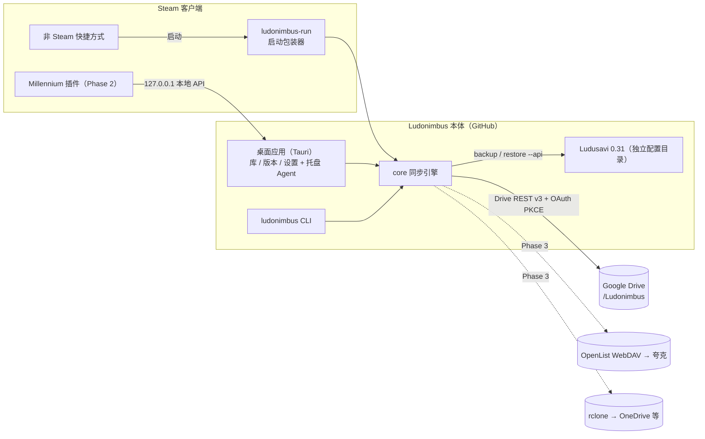
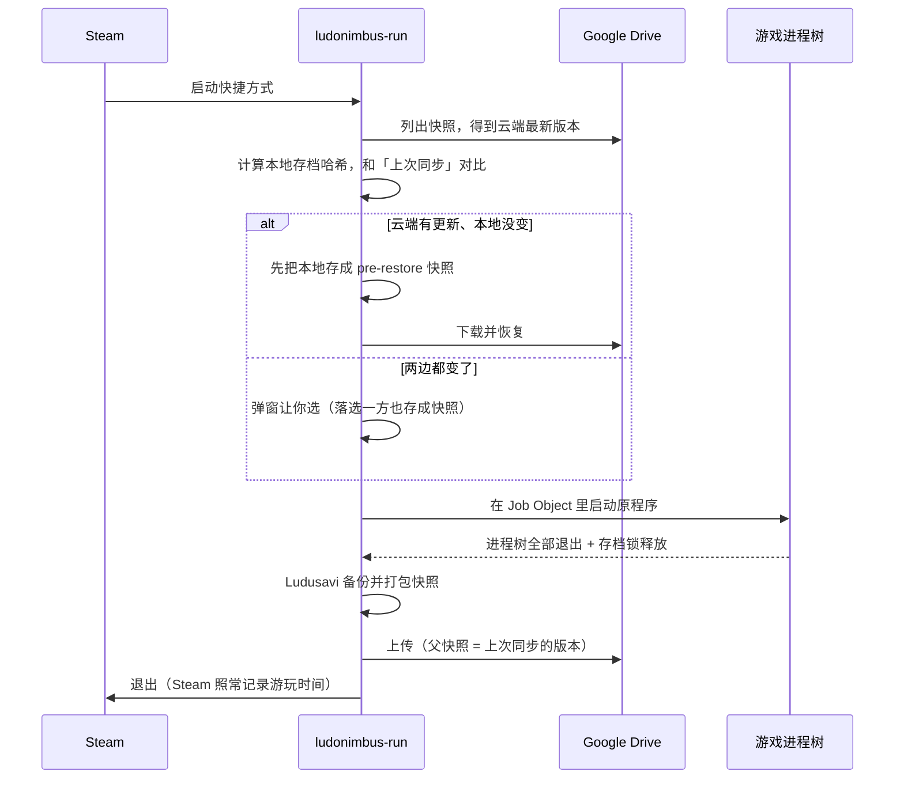

# Ludonimbus 初期实现方案（草案 v0.1 · 2026-11-22）

> **定位**：给 Steam 里的「非 Steam 游戏」（模拟器、重制版/recomp、第三方游戏）补上 Steam 云存档那样的体验：启动前自动拉取、退出后自动上传、多设备多版本、删游戏不丢存档。后续再补游戏本体上云、成就、封面等。
>
> **两个交付物**
> 1. **Ludonimbus 本体**（GitHub 开源）：同步引擎 + 桌面图形界面 + Steam 启动包装器，一键连接网盘。不装 Millennium 也能完整使用。
> 2. **Ludonimbus Millennium 插件**（贡献到 Millennium 社区）：把本体的能力嵌进 Steam 界面，外加 Steam 内的小功能（成就弹窗、SteamGridDB 封面等）。插件本身不碰网盘凭据，只调用本体的本地 API。

---

## 1. 本机现状（2026-11-22 调研）

### 1.1 第一阶段的 3 个游戏

| 游戏 | Steam 快捷方式指向 | 运行方式 | 存档位置 | 大小 | 注意点 |
|---|---|---|---|---|---|
| 塞尔达传说：时之笛 | `%LOCALAPPDATA%\Programs\LongshotLauncher\LongshotLauncher.exe` | Longshot Launcher（本地构建的原生版） | `%APPDATA%\Longshot\save\<id>\`（`account.sav`、`option.sav`、`slot_00…`） | 1.3 MB | 运行时有 `save-work\` 工作副本 + `.lock` 锁文件，只同步 `save\`，且要等锁释放；启动器会另起游戏进程 `longshot.exe`（构建在 `%USERPROFILE%\Games\Longshot\rc\<版本>\`） |
| 火焰纹章：万缕千丝 | `…\Switch\fefw-recomp-0.2.6\fefw.exe` | recomp 原生版 | `<游戏目录>\save\`（`fefw.ini` 里 `save_dir = save`，相对路径） | 66 KB | **存档在游戏文件夹里**，删文件夹即丢；文件夹名带版本号，换新版本解压到新目录时路径会变 |
| Bloodborne（血源诅咒） | `…\Switch\Bloodborne\BloodbornePC\Bloodborne.exe` | Lantern Engine 0.9.43（基于 shadPS4） | `<游戏目录>\user\savedata\1\CUSA00207\`（`SPRJ0005\` + `SPRJ0005.sce_sys\`） | 15 MB | 存档同样在游戏文件夹里；`Bloodborne.exe` 只有 225 KB，大概率是启动器，真正的进程是 `Lantern Engine.exe`；Lantern 自带的 `user\launcher-backups\` 要排除 |

### 1.2 其他发现

- **Ludusavi 0.31.0** 已下载（未安装到固定位置），配置里 `cloud.remote` 为空、`customGames` 为空，即还没用来备份这几个游戏。0.31.0 的 CLI 已具备我们需要的全部接口：`--config <DIR>`（独立配置目录）、`backup/restore --api`（JSON 输出）、`backup --preview`、`api`（批量 JSON 请求）、`schema`、`wrap`、`redirects`（backup/restore/bidirectional）、`customGames`。
- **Millennium 未安装**。当前稳定版 v3.6.3（2026-11-13），v3.7.0 在 beta。官方插件模板是 `millennium.toml` + Lua 后端 + React/TSX 前端，用 Bun 构建，要求 Millennium ≥ 3.4。
- 本机有 2 个 Steam 账号，3 个快捷方式都在其中一个账号下；Bloodborne 在两个账号下都有。
- 3 个游戏在 `userdata\<账号>\config\grid\` 里**已经有自定义封面/横幅/Logo/图标**（`<appid>p.png`、`_hero`、`_logo`、`_icon`），GUI 可以直接复用，第一阶段不需要 SteamGridDB。
- 识别游戏靠 exe 路径和适配规则，不依赖快捷方式名称（名称可以在 GUI 里改）。（更正：之前调研时以为中文名已损坏，实际是终端显示问题，`shortcuts.vdf` 里的名称是正常的 UTF-8。）

---

## 2. 总体架构



| 组件 | 职责 |
|---|---|
| `core`（Rust 库） | 游戏定义与路径解析、调用 Ludusavi、快照打包、云盘抽象（`CloudProvider`）、同步与冲突判定、Steam `shortcuts.vdf` 读写、本地状态库 |
| `ludonimbus-run` | Steam 快捷方式实际启动的程序：启动前同步 → 启动原程序并等待整个进程树退出 → 退出后备份上传。无控制台窗口 |
| 桌面应用 | 游戏库（网格/列表）、游戏详情与版本时间线、恢复、设备、设置、一键连接 Google Drive；常驻托盘，Phase 2 起为插件提供本地 API |
| `ludonimbus` CLI | 调试和脚本用：`status / backup / restore / sync / list` |
| Ludusavi | 只当「存档定位 + 文件备份/恢复」引擎用（以后 PC 游戏靠它的 manifest 数据库），**不用它自带的 rclone 云同步** |

---

## 3. 关键设计决策

**D1. 以 CLI 方式集成 Ludusavi，不 fork。**
Ludusavi 是 MIT 协议，随本体打包固定版本（0.31.0）的 exe，用 `--config %APPDATA%\Ludonimbus\ludusavi\` 隔离配置，不影响你自己的 Ludusavi 设置。所有调用走 `--api` JSON 输出，CI 里用 `ludusavi schema` 校验格式，升级 Ludusavi 时能第一时间发现变化。不 fork 的原因是能直接跟进上游的 manifest 和修复，不用维护分叉。引擎外面包一层 `SaveEngine` trait：万一 Ludusavi 的备份目录结构在跨设备恢复时太难处理，可以换成自研打包器，上层不受影响。

**Ludusavi 怎么带给用户：用户只装、只打开一个 Ludonimbus。**
- GitHub 仓库里**既不放 Ludusavi 源码，也不放它的 exe**。构建时（本地脚本和 GitHub Actions）从 Ludusavi 官方 GitHub Release 下载固定版本，校验 SHA-256 后，作为 Tauri 的 sidecar（`externalBin`）打进安装包，同时附上 Ludusavi 的 MIT LICENSE。
- 安装目录大致是：`Ludonimbus.exe`（桌面应用）、`ludonimbus-run.exe`（启动包装器）、`ludusavi.exe`（引擎）。
- Ludusavi 只在后台以命令行方式调用（`CREATE_NO_WINDOW`，不弹窗），用户感觉不到它存在。用户自己有没有装 Ludusavi 都不影响，两边的配置互不干扰。

**第一版实现中的调整（2026-11-22）：打包和恢复由 Ludonimbus 自己做，Ludusavi 负责「找存档」。**
- 原因：模拟器 / 重制版的存档位置来自我们自己的规则，用不到 Ludusavi 的数据库；而存档要按 `{install}` 这类逻辑根目录记录，换版本目录、换电脑时才能直接恢复，自己打包比给 Ludusavi 生成 redirect 更简单可靠。
- Ludusavi 仍然随包附带：从它的数据库添加的 PC 游戏，每次同步前用 `ludusavi backup --preview --api` 查出存档文件，再由 Ludonimbus 按根目录打包。
- 限制：暂不支持存在注册表里的存档（Ludusavi 能备份注册表，这部分以后再接）。

**D2. 版本、设备、冲突由 Ludonimbus 自己管，不用 Ludusavi 的云同步。**
Ludusavi 的云同步是把整个备份目录用 rclone 镜像过去，没有「哪台设备、基于哪个版本」的概念，多设备时只能整体覆盖。我们需要的是每个游戏独立的、带设备信息和父版本指针的快照链。

**D3. 第一阶段直连 Google Drive API，不经过 rclone。**
「一键连接」要的是：点按钮 → 浏览器登录 Google → 回到应用就完成。原生实现最干净（OAuth 桌面应用流程：回环地址 `127.0.0.1` + PKCE S256，这是 Google 对桌面应用推荐的方式）。rclone 留到 Phase 3，作为另一个 `CloudProvider` 实现，用来一次性接入 OneDrive / Dropbox / WebDAV 等。

**D4. Google OAuth：发布者注册一次应用，用户只需登录；范围用 `drive.file`，云端目录可见。**
- **谁注册应用**：只有发布者（项目作者）在 Google Cloud 做一次：建项目 → 启用 Drive API → 配置同意屏幕（应用名、支持邮箱，建议附一个放在 GitHub Pages 上的隐私政策页）→ 创建「桌面应用」类型的 OAuth 客户端 → 发布为正式版。得到的 Client ID 内置进发布包。
- **用户做什么**：点「连接 Google Drive」→ 浏览器里登录自己的谷歌账号 → 点同意 → 完成。不需要碰 Google Cloud。
- 只申请非敏感范围时，用户不会看到「Google 尚未验证此应用」的警告，也没有「未验证应用最多 100 个新用户」的限制。这两条只针对敏感或受限范围。
- 注意：用 `drive.file` 时，**不同 Google Cloud 项目之间看不到对方创建的文件**。所以「使用自己的 Client ID」只作为高级选项（给想自建的人，或官方 Client ID 出问题时的备用），切换后看不到之前用官方版上传的存档。
- `drive.file` 是 Google 列为**非敏感**的范围，只能访问本应用创建的文件，不用走受限范围（完整 `drive`）的安全评估。
- 目录放在「我的云端硬盘 / Ludonimbus」，可见。这样即使不装本软件，也能在网页版 Drive 里手动下载存档，符合「绝不丢」的目标。（`drive.appdata` 是隐藏目录，用户看不到，不选它。）
- **坑**：OAuth 同意屏幕如果停在「测试」状态，refresh token **7 天就过期**。所以要把发布状态切到「正式版」。
- refresh token 存在 Windows 凭据管理器（`keyring` crate），不写进明文配置。
- 开源桌面应用的 client secret 本来就不算机密。发布版内置默认 Client ID，高级设置里允许填自己的 Client ID。

**D5. 云端快照不可变、只追加；不维护可变的 head 指针。**
Drive 的文件更新没有可靠的条件写入（CAS），所以不维护一个会被并发改写的 `head.json`：每次同步只新增快照，每个快照记录自己的父快照。两台设备同时上传，会出现两个快照共用一个父快照，下次同步时识别为分叉，按冲突处理。个人使用场景下并发极少，这个方案简单可靠。

**D6. 存档路径用「逻辑根目录」表达，每台设备各自解析。**
火焰纹章和血源的存档跟着游戏目录走，游戏目录又可能变（换版本、换盘符、换电脑）。所以游戏定义里写的是 `{game}/save/**`，`{game}` 取自该设备上 Ludonimbus 记录的游戏目录（首次启用时从 Steam 快捷方式读取，之后的更新见第 7.3 节）。快照里记录备份时的根目录；恢复到不同路径时，自动生成 Ludusavi `redirects`（源 = 快照里的根目录，目标 = 当前根目录）。

**D7. 和 Steam 的联动靠「启动包装器」，不靠 Millennium。**
启动前拉取必须在游戏读存档**之前**完成。Steam 前端的游戏生命周期通知要等进程起来才触发，来不及。所以由快捷方式直接启动 `ludonimbus-run`，原理和 `ludusavi wrap` 相同。好处是不装 Millennium 也能用；Millennium 插件只负责展示和操作。

**D8. 技术栈：Rust（core / CLI / 包装器）+ Tauri 2 + React + TypeScript（桌面端）。**
- Rust：和 Ludusavi 同生态，Windows 进程 API（Job Object）好用，产物是单个 exe。
- Tauri + React：容易做出 Steam 风格的界面；Millennium 插件前端也是 React/TSX，UI 组件和 API 类型可以共用。
- 不在 Ludusavi 的 iced GUI 上改：不好做成 Steam 那种封面网格的视觉，而且会被绑在 fork 上。

---

## 4. 云端布局与快照格式

```
我的云端硬盘/Ludonimbus/
├─ devices/
│  └─ <device-id>.json          设备名、系统、最后在线时间（每台设备只写自己的文件，避免争用）
├─ games/
│  └─ <game-key>/
│     ├─ game.json              游戏定义的副本（新设备装好软件后可以直接认出这个游戏）
│     └─ snapshots/
│        ├─ <ULID>.zip          Ludusavi 备份产物
│        └─ <ULID>.json         快照元数据
└─ installs/                    （Phase 3）游戏本体分卷
```

- 快照 ID 用 ULID，按时间排序。
- 关键元数据（设备、父快照、内容哈希、触发方式）同时写进 Drive 文件的 `appProperties`，列一次目录就能拿到整条版本链，不用逐个下载 json。

快照元数据示例：

```json
{
  "id": "01JDB6Z5Q3...",
  "game": "fe-fortunes-weave",
  "parent": "01JD9X0C2M...",
  "device": { "id": "d-7f3a", "name": "Desktop-Main" },
  "createdAt": "2026-11-22T10:15:00Z",
  "trigger": "auto-exit",
  "roots": { "game": "D:/Games/fefw-recomp-0.2.6" },
  "contentHash": "blake3:…",
  "files": [{ "path": "{game}/save/account/…/Auto", "size": 12345, "hash": "blake3:…" }],
  "engine": { "ludusavi": "0.31.0", "ludonimbus": "0.1.0" },
  "comment": "",
  "locked": false
}
```

- `trigger` 的取值：`auto-exit`（退出后自动）、`pre-launch`（启动前补传）、`manual`（手动）、`pre-restore`（恢复前自动保护）、`conflict-keep`（冲突中落选的一方）。
- **保留策略**（默认值，可在设置里改）：自动快照保留最近 20 个；另外每天保留 1 个，保留 30 天；手动快照和锁定快照永久保留。内容哈希没变时不生成新快照。
- 按目前的体量，Bloodborne 15 MB × 50 个约 750 MB，Google Drive 免费的 15 GB 足够。

---

## 5. 同步流程



### 5.1 启动前判定表

本地状态库（`%APPDATA%\Ludonimbus\state.db`，SQLite）为每个游戏记录 `lastSyncedSnapshot` 和 `lastSyncedHash`。

| 本地存档自上次同步后 | 云端自上次同步后 | 动作 |
|---|---|---|
| 未变 | 未变 | 直接启动 |
| 未变 | 有新快照 | 本地先存一个 `pre-restore` 快照，然后拉取云端，再启动 |
| 已变（比如在包装器外玩过） | 未变 | 先上传本地快照，再启动 |
| 已变 | 有新快照 | **冲突**：弹窗显示双方的设备、时间、大小，选「用云端 / 用本地」；落选的一方也上传为 `conflict-keep` 快照，**任何情况下都不删数据** |
| 本地没有存档 | 有快照 | 直接拉取（**重装游戏后找回存档**就是这一行） |
| 本地状态未知（新电脑、状态库丢失） | 有快照 | 本地存档和云端最新版本内容一致就当作已同步；不一致就按冲突处理 |
| 离线或超时（默认 8 秒） | — | 直接启动，退出后排队上传，并用通知提示 |

### 5.2 退出后

1. **等进程**：用 Windows Job Object 跟踪整个进程树，进程数归零才算退出，这样能处理「启动器先退、游戏另起进程」的情况。兜底方案：游戏定义里可以写 `waitFor: ["Lantern Engine.exe"]`，按进程名等待。
2. **等存档写完**：适配规则里的条件，比如 Longshot 的 `save-work\*.lock` 消失。
3. 计算哈希；有变化才用 Ludusavi 备份，打包后上传。
4. 上传时如果发现云端已经被别的设备推进了，就标记为分叉，下次启动时提示；同时在托盘弹通知。
5. 用 Windows 通知提示「已同步到云端」，体验和 Steam 云同步一致。

---

## 6. 游戏定义与适配器

适配器规则是仓库里的 [`adapters/builtin.yaml`](../adapters/builtin.yaml)，以后可以由社区贡献，像 ludusavi-manifest 那样。路径以 `{install}`（游戏目录）、`{appdata}` 等根目录开头，每台设备各自解析。第一阶段内置的 3 条（节选）：

```yaml
- key: zelda-oot-longshot
  match: { exe: LongshotLauncher.exe }
  roots: { data: "{appdata}/Longshot" }
  saves: ["{data}/save/**"]
  exclude: ["{data}/save-work/**"]
  waitFor: ["longshot.exe"]                 # 启动器拉起的真正游戏进程
  quiesce: { absent: ["{data}/save-work/*.lock"] }

- key: fe-fortunes-weave
  match: { exe: fefw.exe }
  saves: ["{install}/save/**"]
  relocate: { exe: fefw.exe, dirPattern: "fefw-recomp-*" }   # 换新版本文件夹时自动找

- key: bloodborne-lantern
  match: { exe: Bloodborne.exe, sibling: "Lantern Engine.exe" }
  saves: ["{install}/user/savedata/1/CUSA00207/**"]
  exclude: ["{install}/user/launcher-backups/**", "{install}/user/cache/**"]
  waitFor: ["Lantern Engine.exe"]
```

**「尝试用数据库查找」的路线**：
- PC 游戏：交给 Ludusavi manifest（来自 PCGamingWiki），用 `api` 的 `findTitle` 查。
- 模拟器：做「模拟器适配器」。先识别出模拟器和游戏 ID（从快捷方式的 exe 和启动参数里解析 ROM 路径或 Title ID），再套用存档路径模板。后续按需加 Ryujinx 系 / Eden 等 yuzu 系（Switch Title ID）、shadPS4（CUSA）、RPCS3、Dolphin、PCSX2（记忆卡是多个游戏共用的，需要特殊处理）、RetroArch、Cemu、PPSSPP。
- 都匹配不上时：在 GUI 里手动选文件夹。

---

## 7. Steam 接入与模拟器更新兼容（Phase 1，不依赖 Millennium）

### 7.1 读取

- **快捷方式**：解析 `Steam\userdata\<账号>\config\shortcuts.vdf`（二进制 KeyValues 格式）。有多个账号时让你选。按 exe 路径和适配规则匹配游戏。
- **封面**：从 `config\grid\` 读 `<appid>p.*`（竖版封面）、`_hero`、`_logo`、`_icon`。

### 7.2 开启自动同步：快捷方式里只写游戏 ID，不写游戏路径

改写该快捷方式（写之前备份 vdf）：
- `Exe` 改为 `"%LOCALAPPDATA%\Programs\Ludonimbus\ludonimbus-run.exe"`。这个路径固定不变，Ludonimbus 自己升级时原地替换，所以快捷方式一直有效。
- `LaunchOptions` 改为 `--game fe-fortunes-weave`。**只有游戏 ID，没有游戏路径。**
- `StartDir` 不变。
- `icon` 设为原 exe，保留原来的图标。
- **`appid` 不变**，封面、游玩时间、收藏分类都不受影响。

游戏的真实路径（exe、启动参数、工作目录）**只记录在 Ludonimbus 一个地方**。模拟器更新时只需更新这一处，Steam 快捷方式开启同步之后就不用再动。原始字段存进状态库，关闭自动同步时原样还原。

**必须在 Steam 关闭时写入**，否则 Steam 退出时会覆盖文件。应用里检测 `steam.exe` 是否在运行，提供「关闭 Steam 并应用」按钮。Phase 2 改由 Millennium 插件在 Steam 运行时直接修改。

### 7.3 模拟器或游戏更新后，怎么保证还能关联上

| 更新方式 | 例子 | Ludonimbus 怎么处理 | 你需要做什么 |
|---|---|---|---|
| 原地覆盖更新（exe 路径不变） | 火焰纹章 README 推荐的「解压覆盖到原文件夹」；Longshot 启动器自更新 | 路径没变，照常启动 | 什么都不用做 |
| 解压到新文件夹（路径变了） | `fefw-recomp-0.2.6` → `fefw-recomp-0.2.7` | 包装器启动时发现原 exe 不存在 → 按适配器的 `relocate` 规则，在原位置的上级目录里找新版本（同名 exe；文件夹名去掉版本号后相同的，取版本号最大的）→ 弹窗确认 → 更新路径 → 新文件夹里没有存档就自动从云端拉取 → 启动 | 点一次「确认」 |
| 自动找不到新位置 | 换了盘符、改了文件夹名 | 弹出文件选择框，让你指向新的 exe | 选一次文件 |
| 在 Steam 里改了快捷方式目标，或模拟器自带的「添加到 Steam」重建了快捷方式 | 包装器被覆盖掉，或多出一个指向同一游戏的新快捷方式 | 托盘程序监视 `shortcuts.vdf`：发现已开启同步的游戏不再经过包装器，或有新快捷方式指向已知游戏 → 通知「检测到火焰纹章的快捷方式已更改」→ 一键修复：采用新路径，重新接上包装器 | 点一次「修复」 |
| 绕过 Steam，直接双击 exe 启动 | — | 托盘程序监视已知游戏的进程，游戏退出后照样备份上传（只是启动前不会自动拉取） | 什么都不用做 |
| 想主动换路径 | — | 游戏详情页的「重新定位游戏」按钮 | 手动操作 |

- 游戏库里每个游戏都有健康状态：正常 / 快捷方式已变 / 找不到游戏。异常会显示在封面角标上，**同步不会悄悄失效**。
- 存档路径由当前游戏目录推导（第 3 节 D6），游戏目录一更新，存档位置跟着更新。Ludusavi 的配置每次运行前重新生成，不会残留旧路径。

### 7.4 待验证的替代方案

在 Steam 启动参数里用 `%command%`：`"…\ludonimbus-run.exe" --game <key> -- %command%`。这样 `Exe` 保持原样，你在 Steam 里改目标路径也不会破坏包装器。目前没找到 Windows 下非 Steam 快捷方式是否支持 `%command%` 的权威说法，放进 M0 实测；如果支持，就作为可选模式。

---

## 8. 桌面图形界面（Phase 1）

| 页面 | 内容 |
|---|---|
| **游戏库** | Steam 风格的竖版封面网格，可切换成列表；每个游戏显示状态角标（已同步 / 待上传 / 冲突 / 离线 / 未启用）、最后同步时间和设备；可搜索、筛选 |
| **游戏详情** | hero 横幅 + Logo；存档位置（可一键打开文件夹）；自动同步开关；**版本时间线**（时间、设备名、大小、触发方式、备注、锁定），每个版本可「恢复」（恢复前自动保护当前存档）、「下载 zip」、「和当前存档对比文件差异」；「立即上传」按钮 |
| **设备** | 所有设备、各自最后在线时间；本机设备名可改（默认用 Windows 计算机名） |
| **设置** | 一键连接 Google Drive（显示账号和剩余空间，可断开）、云端目录名、保留策略、Steam 账号、开机自启 / 托盘、语言 |
| **添加游戏向导** | 从 Steam 快捷方式里选 → 适配器自动识别 → 显示推测的存档路径和当前文件列表（来自 `backup --preview --api`）→ 确认或手动改 → 「在 Steam 中启用自动同步」 |

---

## 9. Millennium 插件（Phase 2）

- **结构**：`millennium.toml` + `backend/main.lua`（`---@ffi` 函数供前端调用）+ `frontend/index.tsx`，用 Bun 构建。在本仓库 `plugin-millennium/` 里独立构建，提交社区时用 `git subtree split` 拆成独立仓库。
- **功能**：
  - 在非 Steam 游戏的详情页注入「云存档」状态条，类似 Steam 的「云同步状态：已是最新」，点开是版本列表弹窗，提供「立即同步」。
  - 在 Steam 运行时直接为快捷方式开启或关闭自动同步（通过 SteamClient 的快捷方式 API，具体接口名待验证），不用重启 Steam。
  - 用 Steam 风格的通知展示同步结果和冲突。
- **通信**：插件前端 → Lua 后端 → `127.0.0.1:<端口>` 上的本体 Agent，请求带 token，token 放在 `%APPDATA%\Ludonimbus\agent.json`。也可以让前端直接 `fetch`，取决于 Steam CEF 的 CSP/CORS 限制，在 spike 里定。API 带版本号（`/v1/games`、`/v1/games/{key}/snapshots`、`/v1/sync`，事件用 SSE 推送）。
- **原则**：插件里没有凭据、没有同步逻辑，体积小、易审核，适合提交社区。
- 「改变 Steam 主页样式」属于 Millennium 主题，和本插件分开，作为可选附带项。

---

## 10. 后续阶段路线图

| 阶段 | 内容 | 前置条件 / 要点 |
|---|---|---|
| **Phase 1** | 本体 + Google Drive + 3 个游戏自动同步 + GUI | 见第 11 节 |
| **Phase 2** | Millennium 插件（状态条、版本弹窗、Steam 内开关、通知） | Phase 1 的本地 API 稳定 |
| **Phase 3** | **游戏本体上云 + 在 Steam 里「从云端安装」** | **先做内置测速**（上传和下载各 200 MB），按实测速度决定是否启用。打包方式：游戏目录排除存档和缓存后切成 zstd 分卷，配一份带哈希的清单，支持断点续传、并行下载、校验和增量更新。本体缺失的快捷方式在 Steam 里显示「从云端安装」，下载后自动修正快捷方式路径并拉取存档 |
| | 网盘扩展 | **夸克**：通过 OpenList（AList 的社区分叉，AGPL-3.0）以 WebDAV 接入，只走网络协议，不打包进来。OpenList 官方文档说明夸克驱动是逆向接口、不再主动维护，且受限速影响只能走本地代理中转，**必须先实测**。**rclone provider**：OneDrive / Dropbox 等。Google Drive 单账号每天上传约 750 GB 封顶，备份游戏本体时要考虑 |
| **Phase 4** | **SteamGridDB**：填自己的 API Key，搜索并替换封面、横幅、Logo，通过 SteamClient 的自定义图片 API 写入（Decky 的 SteamGridDB 插件就是这么做的；先看社区有没有现成的 Millennium 插件可以对接） | |
| | **成就** | 这 3 个游戏都不是传统模拟器，RetroAchievements 用不上。思路：① Bloodborne：Lantern 本身支持奖杯（`%APPDATA%\Lantern Engine\trophy-icons` 已存在），读取它的奖杯数据，转成 Steam 风格的弹窗；② 时之笛 / 火焰纹章：基于存档内容的规则成就（比如心之碎片数量、通关章节），刚好复用同步引擎对存档的监视；③ 传统模拟器：接 RetroAchievements Web API。**游戏内弹窗**是难点：Millennium 注入的是 Steam 客户端界面，能否注入游戏内 Overlay 待研究；兜底是置顶透明窗口，只在无边框窗口模式下有效 |

> 游戏本体备份只用于你自己的个人备份，不做分享链接之类的功能，云端目录保持私有。

---

## 11. Phase 1 里程碑与验收

| 里程碑 | 内容 | 验收标准 |
|---|---|---|
| **M0 技术验证** | ① 用独立配置的 Ludusavi 跑火焰纹章 customGame 的 backup/restore，包括用 redirect 恢复到另一个目录；② 用 Job Object 跟踪 `LongshotLauncher.exe` 和 `Bloodborne.exe`，确认它们会不会先退出、游戏进程叫什么；③ `shortcuts.vdf` 读写往返（在副本上做）；④ Google Drive 回环地址 + PKCE 登录，上传和下载一个文件；⑤ 非 Steam 快捷方式能否使用 `%command%` | 5 项都有可运行的最小代码和结论；第 12 节的待验证项清零或给出替代方案 |
| **M1 core + CLI** | 游戏定义加载、路径解析、本地快照的生成和恢复、状态库 | `ludonimbus backup/restore/list` 对 3 个游戏都能用 |
| **M2 云同步** | Drive provider（大文件分块续传）、设备注册、快照链、判定表、保留策略 | `ludonimbus sync` 覆盖第 5.1 节判定表的每一行（有单元测试 + 一个模拟第二台设备的集成测试） |
| **M3 Steam 包装器** | `ludonimbus-run`、启用/还原快捷方式、冲突对话框、Windows 通知 | 从 Steam 启动 3 个游戏都能自动拉取和上传；Steam 游玩时间正常记录；模拟两种更新（火焰纹章换新版本文件夹、在 Steam 里改快捷方式目标），都能被识别并修复 |
| **M4 桌面应用** | 第 8 节的全部页面 | 不用 CLI，全程在 GUI 里完成连接、启用、查看版本、恢复 |
| **M5 验收演练** | **删游戏重装**：删掉整个 `fefw-recomp-0.2.6` → 解压到新目录 → 修正快捷方式 → 从 Steam 启动 → 存档自动回来。Bloodborne 删掉 `BloodbornePC\user` 做同样的测试，时之笛删掉 `%APPDATA%\Longshot\save` 做同样的测试。再加冲突演练：离线时改本地，同时用第二个设备 ID 推一个云端版本 | 3 个游戏全部找回；冲突时双方存档都在版本时间线里 |

---

## 12. 风险与待验证项

| 风险 | 应对 |
|---|---|
| 启动器先退出，游戏进程另起，甚至脱离 Job Object | Job Object 加按进程名等待的兜底；M0 实测 |
| 游戏运行时持续写存档 | 只在退出且锁释放后同步；排除 `save-work` 这类工作目录 |
| Steam 运行时覆盖 `shortcuts.vdf` | 只在 Steam 关闭时写；写前备份；Phase 2 改走 Millennium |
| 模拟器更新后路径变化，或快捷方式被覆盖 | 快捷方式只写游戏 ID，路径由 Ludonimbus 统一管理；自动找新版本、监视 vdf、监视进程兜底（见 7.3） |
| 快捷方式被删掉重新添加后 appid 变了 | 以自己的 `game-key` 为准；检测到新快捷方式时按 exe 和适配器提示「这是不是之前的 xxx？」并重新关联 |
| OAuth 停在测试状态，7 天后掉线 | 发布状态切到正式版；掉线后一键重新登录，不影响本地数据 |
| Ludusavi 输出格式随版本变化 | 固定版本；CI 用 `schema` 校验；`SaveEngine` 抽象可替换 |
| Steam Overlay 能否覆盖包装器启动的子进程 | M3 实测；不行就在文档里说明 |
| 夸克 / OpenList 稳定性和速度 | Phase 3 先测速；作为实验性 provider |

---

## 13. 仓库结构建议

先用一个 monorepo，提交插件时再拆出去：

```
ludonimbus/
├─ crates/
│  ├─ core/              同步引擎、快照、CloudProvider、Steam vdf、Ludusavi 适配
│  ├─ cli/               ludonimbus
│  └─ runner/            ludonimbus-run（Windows 子系统，无控制台）
├─ app/                  Tauri 2（src-tauri 依赖 core；前端 React + TS + Vite）
├─ adapters/             模拟器 / recomp 存档规则（YAML）
├─ plugin-millennium/    Millennium 插件（独立构建，日后拆仓库）
├─ third_party/ludusavi/ 构建时下载固定版本 + LICENSE
└─ docs/
```
