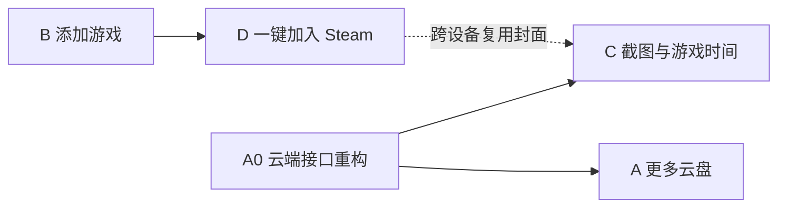

# Ludonimbus 下一阶段方案（草案 v0.1 · 2026-11-23）

> **背景**：0.2 已经完成了 Google Drive / 本地文件夹同步、Steam 包装器、版本历史和 Steam 游戏页状态栏。接下来按下面四个方向推进，[plan-phase1.md](plan-phase1.md) 第 9、10 节里还没做的部分先放一放（见第 7 节）。
>
> | 方向 | 一句话 |
> |---|---|
> | **A. 更多云盘** | 国内网盘、自建 NAS 都能当云端 |
> | **B. 添加游戏** | 扫描本机已有的游戏和存档；认不出的游戏一步步引导用户设置 |
> | **C. 截图与游戏时间** | Steam 截图、游戏时间也上云，换电脑能找回 |
> | **D. 一键加入 Steam** | 直接加进 Ludonimbus 的游戏，一键加入 Steam 并开启云存档，从 SteamGridDB 选封面 |

---

## 0. 建议顺序

| 版本 | 内容 | 理由 |
|---|---|---|
| **0.3** | B + D | 两者都在改「游戏怎么进入 Ludonimbus」，共用一次添加游戏流程的改版；D 创建快捷方式可以直接复用现有的 `steam::wrap` 和关闭/重启 Steam 的流程 |
| **0.4** | A0 + A | 只改 `cloud` 模块，和 B/D 互不影响；先把接口拆成通用对象存储，新云盘只需实现几个基本操作 |
| **0.5** | C | 截图和游戏时间需要往云端存「快照以外的东西」，在 A0 的新接口上做最省事 |

A 和 B/D 之间没有依赖，如果国内网盘更急，可以把 0.3 和 0.4 对调；C 最好排在 A0 之后。

> **2026-11-23 决定**：先做 A，作为 0.3；B + D 顺延到 0.4。
>
> **进度**：A 已在 0.3 发布（百度网盘一键登录等审核）。B + D 已实现，测试清单见 [testing-v0.4.md](testing-v0.4.md)。
>
> **2026-11-23 调整**：0.5 改做夸克一键连接、首次使用引导、多语言和文档网站，见 [plan-phase3.md](plan-phase3.md)；C 顺延到 0.6。

---

## 1. 方向 A：更多云盘

> **进展（2026-11-23）**：A0 重构、WebDAV、S3 兼容存储、换云盘时复制存档已完成，测试清单见 [testing-v0.3.md](testing-v0.3.md)。实现与下文的差别：
> - Google Drive 没有改到 `Store` 上，仍直接实现 `CloudProvider`（它按文件 id 操作，并用文件属性一次列出全部版本），其他云盘都走 `Store` + `Repo`。
> - 元数据缓存在 `%APPDATA%\Ludonimbus\cloud-cache\`，按 (路径, etag) 命中。
> - WebDAV 上传大文件前先确认父文件夹存在：实测服务器会在还没读完请求体时就返回 409 并断开连接。
> - 换云盘时把旧云盘记为 `previousCloud`，设置页询问是否复制；复制会跳过新云盘里已有的版本，可以中断后重来。
> - 自签名 HTTPS 证书暂不支持，提示用户改用 http:// 或受信任的证书。
>
> - 百度网盘一键登录已完成（设备码模式，不需要回调地址），用模拟 xpan 接口的测试服务验证；发布前需要注册开放平台应用，见 [baidu-netdisk-setup.md](baidu-netdisk-setup.md)。设备码轮询的返回已实测：尚未授权时 HTTP 400 `{"error":"authorization_pending"}`，轮询太快时 `slow_down`，和标准 OAuth 一致；父文件夹会先显式创建（文档没说会自动创建）。
> - 百度网盘真实账号实测（2026-11-23，应用未提交审核，开发者本人账号）：设备码登录、子文件夹创建、覆盖写入、9 MB 分片上传（约 9 秒）、经 302 的下载、删除都正常。每个小请求约 1 秒，读一个小文件约 4 秒（列目录 + 取下载链接 + 下载）。**非会员下载被限速，9 MB 用了约 116 秒（约 80 KB/s）**，存档较大时拉取会慢；设置页已提示。以后可以优化：批量取下载链接，减少新设备第一次列出版本时的请求数。
> - **夸克**（2026-11-23 调研）：没有找到面向个人开发者的官方开放平台。OpenList 的「Quark Open」驱动用的是没有文档的接口，需要用户自己提供来源不明的 AppID / SignKey，刷新 token 要经过第三方中转服务；「Quark TV」驱动是逆向的电视端接口，只能读不能写。夸克已接入阿里的千问开放平台，但那是阿里自家的集成。结论：现在不做夸克一键登录，继续推荐通过 OpenList 的 WebDAV 接入，有官方开放平台后再评估。
>
> - 0.3.0 发布时不开放百度网盘：发布版没有内置百度应用，设置页会隐藏百度网盘选项（开发版和已连接的设备除外）。审核通过后，把 `LUDONIMBUS_BAIDU_*` 加进 GitHub Secrets 再发一个版本即可开放。
>
> 还没做：rclone。

### 1.1 现状

`CloudProvider`（[cloud/mod.rs](../crates/core/src/cloud/mod.rs)）有 12 个方法，每个都和快照、设备、游戏这几种对象绑定；实现只有 `LocalFolder` 和 `GoogleDrive`。`LocalFolder` 已经能覆盖 SMB 映射的 NAS 和各家网盘的同步文件夹客户端。

### 1.2 A0：把云端接口拆成两层

- **`Store`**（每种云盘实现一次）：`put(path, file)`、`get(path, dest)`、`list(prefix) -> [{path, size, etag, modified}]`、`delete(path)`、`stat(path)`，外加可选能力 `properties`（Drive 的 `appProperties`）。
- **`Repo`**（所有云盘共用）：云端目录布局、快照链、设备、游戏定义，以后再加截图和游戏时间。现有的 `CloudProvider` 方法都挪到这一层实现。
- **元数据缓存**：没有 `appProperties` 的云盘，列快照时要逐个下载 `<ULID>.json`。在本机按 `(路径, etag)` 缓存，etag 没变就不重新下载；备注和锁定改了 etag 会变，所以缓存不会过期。WebDAV 的 `PROPFIND` 和 S3 的 `ListObjects` 都会返回 etag。
- **上传原子性**：先传到 `<名字>.uploading`，传完再改名（WebDAV `MOVE` / S3 直接 `PUT` 本身就是原子的），中断的上传不会被当成有效快照；`list` 时忽略并清理过期的 `.uploading`。

### 1.3 支持顺序

| 优先级 | 后端 | 覆盖的用户 | 要点 |
|---|---|---|---|
| 1 | **WebDAV**（自己实现，reqwest + `PROPFIND/MKCOL/PUT/GET/MOVE/DELETE`） | 群晖、威联通等 NAS 自带的 WebDAV；Nextcloud；坚果云；**OpenList / AList**（转接百度、阿里、夸克、115、天翼等）；`rclone serve webdav` | 地址、用户名写配置，密码放 Windows 凭据管理器（和 Drive 的 refresh token 一样）。设置页给出「群晖 / 坚果云 / OpenList」的填写示例和「测试连接」按钮（写入、读回、删除一个测试文件）。坚果云有请求频率限制，需要实测一次完整同步的请求数 |
| 2 | **S3 兼容** | NAS 上的 MinIO；阿里云 OSS、腾讯云 COS、Cloudflare R2 等对象存储 | Endpoint、Bucket、前缀、Access Key；Secret 放凭据管理器；支持 path-style。选一个轻量的 SigV4 实现，不引入完整的 AWS SDK |
| 3 | **百度网盘**（原生，一键登录） | 国内最常见的网盘 | 需要发布者在百度网盘开放平台注册应用（和 Google OAuth 一样是发布者的手动步骤）。文件只能放在 `/apps/<应用名>/` 下；上传流程是预创建 → 4 MB 分片 → 合并，第三方文档称每个分片必须在 30 秒内传完；非会员可能限速。登录用设备码或授权码流程。**先做技术验证再决定** |
| — | 阿里云盘 | — | 2024 年起第三方应用需要用户另购「三方应用权益包」才能完整使用（据 IT 之家报道），不适合做默认选项。引导用户用它的官方 WebDAV 或 OpenList 走第 1 项 |
| — | 夸克、115、天翼、123 等 | — | 通过 OpenList 的 WebDAV 接入，在文档里标为「实验性」（夸克驱动是逆向接口，见 plan-phase1 第 10 节） |
| 以后 | rclone | OneDrive、Dropbox 等 | 调用用户自己配置好的 rclone remote；WebDAV 已经覆盖大部分需求，先不做 |

### 1.4 切换云盘

用户会从 Google Drive 换到 NAS，或者反过来。设置里加「迁移到新云盘」：把旧云盘里的设备、游戏定义和全部快照复制到新云盘，校验哈希后再切换；旧云盘的数据保留不动。

### 1.5 测试

- WebDAV：测试里用 `dav-server` crate 在本机起一个 WebDAV 服务，跑和 `LocalFolder` 相同的同步集成测试。
- S3：签名用 AWS 文档里的测试向量做单元测试；完整流程在本机 MinIO 上手动测。
- 百度网盘：只能手动测，写进测试清单。

---

## 2. 方向 B：添加游戏

> **0.4 实现情况**：
> - 已做：Steam 快捷方式（所有账号，默认账号优先）、Ludusavi 全量扫描（并标出 Steam 云已同步、存档只在注册表的游戏）、Epic、GOG、Xbox 应用（`.GamingRoot` + `MicrosoftGame.config`；游戏自己的程序加密、别的程序读不了也启动不了，所以用 Content 里的 `gamelaunchhelper.exe` 启动，并按配置里的程序和 Content 里的 exe 名判断游戏是否在运行）、指定文件夹；Ludusavi 找到存档的游戏按商店名称和清单里的 `installDir` 去 Epic / GOG / Xbox / 卸载注册表（EA、Ubisoft 等）/ 游戏文件夹里找安装位置；选游戏程序时提供各平台安装目录的快捷入口；B2 向导的 Ludusavi 搜索、常见位置、「玩一下再找」、手动选文件夹、200 MB 提醒；添加后提示加入 Steam。
> - 和设计不同：没有加 `source` 字段，再次扫描时按 exe 路径、Steam 快捷方式和 Ludusavi 名称认出已添加的游戏；扫描结果在前端按 exe 和名称合并。
> - 「Steam 云已在同步」的判断：Steam 现在装着这个游戏（主 id、清单里的其他版本 id 或名称），并且清单标了 Steam 云 / 有 Auto-Cloud 标记 / 有 userdata 副本；或者存档全在 userdata 里。Steam 卸载后留下的标记不再算。
> - 还没做：EA app、Ubisoft Connect 的专用清单（目前靠卸载注册表）、exe 版本信息里的 ProductName、分享规则。
> - 模拟器和重编译游戏的规则（2026-11-23）：19 个模拟器（`adapters/emulators.yaml`），Dolphin、Cemu、Azahar / Citra / Lime3DS、RPCS3、shadPS4、PPSSPP、Vita3K、RetroArch 从快捷方式的游戏文件读出游戏 ID，按游戏同步；Switch 模拟器（存档编号和用户档案跟本机绑定）、PCSX2 / DuckStation（共用记忆卡）、Xenia 整体同步，一个模拟器只允许一个整体同步的条目。重编译 / 移植游戏：手写 13 条，另外 132 条由 `scripts/import-recomplauncher.py` 从 RecompLauncher 目录生成（111 条开发者声明的存档位置，21 条 N64Recomp）。RecompLauncher 装的游戏作为扫描来源，它建的 `--play <id>` 快捷方式也能认出。
> - 和设计不同：没有单独的「模拟器 + 游戏 ID」记录，按游戏的存档模板在添加时填好写进 `saves`，模拟器的数据目录仍由规则的根目录（可列多个候选）在每台电脑上解析。模拟器数据目录扫描和 Ryujinx 按游戏同步也已完成（见下一条）。
> - 模拟器数据目录扫描、Ryujinx 按游戏同步（2026-11-23）：「扫描本机」逐个列出模拟器里有存档的游戏（来源 `emulator`），找得到游戏文件时（Ryujinx、Dolphin、Cemu）带上启动参数。Ryujinx 用 `{nxsave-<ID>}` / `{nxdevice-<ID>}` 动态根目录，每台电脑查存档索引；恢复时没有就按 Ryujinx 的方式新建（索引条目 + ExtraData），见 `docs/development.md`。同一个模拟器整体同步和逐个游戏二选一。Eden / yuzu 系仍整体同步。

### 2.1 现状

「添加游戏」有四个标签页：Steam 快捷方式 / 云端 / Ludusavi 搜索 / 手动。只有 Steam 快捷方式会自动识别，其他都要用户自己知道游戏叫什么、存档在哪。

### 2.2 B1：扫描本机（新的默认入口）

一个「扫描本机」页面，后台并行扫下面几个来源，结果分成三组：**可以直接添加** / **找到了存档，需要确认** / **认不出来**，支持多选批量添加。

| 来源 | 怎么找 | 得到什么 |
|---|---|---|
| Steam 非 Steam 快捷方式 | 现有逻辑，扩展到所有 Steam 账号 | exe、名称、封面；套用适配器 |
| **Ludusavi 全量扫描** | `ludusavi backup --preview --api` 不带游戏名，扫描它数据库里的全部游戏 | 本机**已经有存档**的 PC 游戏。数据库里标记了「有 Steam 云存档」的商店游戏放到最后或隐藏，避免重复。需要在隔离配置里写好各启动器的 roots；扫描可能要几十秒，放后台并缓存结果 |
| 其他启动器 | Epic（`%ProgramData%\Epic\EpicGamesLauncher\Data\Manifests\*.item`）、GOG（注册表 `GOG.com\Games`）、EA app、Ubisoft Connect | 已安装但可能还没存档的游戏：名称、安装目录、exe。按名称去 Ludusavi 数据库匹配存档规则 |
| 模拟器 | 识别常见模拟器的数据目录（常见安装位置 + 用户指定），按游戏 ID 列出已有存档：Ryujinx / Eden 系（Switch Title ID）、shadPS4（CUSA）、RPCS3、Dolphin、PCSX2、PPSSPP、RetroArch | 「模拟器 + 游戏 ID」一条记录。存档模板写进适配器（`{emu}` 根目录 + `{titleId}`），和 README 路线图里的「更多模拟器规则」是同一件事。PCSX2 的记忆卡多个游戏共用，按记忆卡整体同步 |
| 指定文件夹 | 用户选 `D:\Games` 这样的目录，递归找 exe，过滤卸载程序、崩溃上报、运行库安装包等 | exe 列表，按适配器、exe 版本信息里的 ProductName、文件夹名去匹配 |

去重：同一个游戏可能被多个来源找到，按「规范化后的 exe 路径」「模拟器 + 游戏 ID」「Ludusavi 名称」合并。`GameEntry` 加一个 `source` 字段记录来源，再次扫描时用来认出已添加的游戏。

### 2.3 B2：认不出来的游戏，引导设置

1. **选 exe**（或从扫描结果点进来）。
2. **自动匹配**：适配器 → 用 exe 名、文件夹名、ProductName 在 Ludusavi 数据库里模糊搜索 → 列出候选让用户确认。
3. **匹配不上就帮用户找存档**，三种方式并列：
   - **常见位置**：列出 `文档\My Games\*`、`保存的游戏`、`%APPDATA%`、`%LOCALAPPDATA%`、`LocalLow`、游戏目录里名字和游戏名或发行商相近的文件夹，按最近修改时间排序。
   - **「玩一下再找」**：从向导里启动游戏，监视用户目录和游戏目录的文件写入；游戏退出后列出被写过的文件夹，自动排除日志、缓存、着色器缓存、崩溃转储，让用户勾选。这是最省心的一种，重点做好。
   - **手动选文件夹**（现有）。
4. **预览**要备份的文件数和大小；超过 200 MB 时提醒「可能选到了整个游戏目录」。
5. **可选：分享规则**。生成一段 `adapters/builtin.yaml` 格式的规则，复制到剪贴板或打开预填好的 GitHub Issue。
6. 完成后，游戏还不在 Steam 里的，提示「加入 Steam」（方向 D）。

---

## 3. 方向 D：一键加入 Steam + SteamGridDB

> **0.4 实现情况**：
> - 已做：加入 Steam（单个 / 批量，批量时只重启一次 Steam）、SteamGridDB 选封面（竖版、横版、背景、Logo、图标）、本地图片、批量时自动选评分最高的封面、`SteamLink.created`、从 Steam 移除快捷方式、移除游戏时一起删掉我们建的快捷方式、不在 Steam 里的游戏在 Ludonimbus 里显示封面（`%APPDATA%\Ludonimbus\art\<key>\`）。
> - 和设计不同：加入 Steam 的对话框里不逐个挑封面，而是「自动配封面」开关；想自己挑在详情页「更换封面」。移除游戏时不再询问，直接删掉 Ludonimbus 建的快捷方式（确认框里写明）。
> - 还没做：封面上传到云端跨设备复用（放到 C 一起做）。Steam 运行时写入 `grid\` 能否立即显示还要实测，目前提示「Steam 重新打开后更新」。

### 3.1 流程

游戏详情页（或扫描结果的批量操作）点「加入 Steam」：

1. **选 Steam 账号**：默认当前登录的账号（`loginusers.vdf` 里的 `MostRecent`）。
2. **选封面**：用游戏名在 SteamGridDB 搜索，分别列出竖版封面（600×900）、横版（920×430）、Hero 横幅（1920×620）、Logo、图标的候选，默认选评分最高的，用户可以换。也可以选本地图片，或者跳过。
3. **写快捷方式**：在 `shortcuts.vdf` 里新建一条，直接就是开启自动同步的状态：
   - `Exe` = `ludonimbus-run.exe`，`LaunchOptions` = `--game <key>`，`StartDir` = 游戏目录，`icon` = 原 exe 或下载的图标，`AppName` = 游戏名。
   - `appid` 按 Steam 生成非 Steam 快捷方式 ID 的通用算法（exe + 名称的 CRC32，再置最高位）预先算好，因为封面文件名要用它。
   - 和现在一样**必须在 Steam 关闭时写**，复用现有的关闭 / 重启流程；批量添加时只重启一次。
4. **写封面**到 `userdata\<账号>\config\grid\`：`<appid>p.png`、`<appid>.png`、`<appid>_hero.png`、`<appid>_logo.png`、`<appid>_icon.png`。
5. **记录**：`SteamLink` 加 `created: true`，表示这条快捷方式是 Ludonimbus 建的。关闭自动同步时恢复成直接启动游戏 exe；移除游戏时询问是否同时删掉这条快捷方式（不是我们建的快捷方式永远不删）。

### 3.2 其他用到 SteamGridDB 的地方

- **已有快捷方式换封面**：详情页「更换封面」，同一个选择器，写入 `grid\`。Steam 运行时写入后多久能显示出来需要实测。
- **Ludonimbus 自己的游戏库**：不在 Steam 里的游戏也能显示封面，图片缓存在 `%APPDATA%\Ludonimbus\art\<key>\`。
- **跨设备**：选好的封面上传到云端 `games/<key>/art/`。新电脑「从云端添加」后一键加入 Steam，封面和第一台电脑一样，不用重新选。

### 3.3 API Key

SteamGridDB API 需要 Key。两个选项：

- **用户自己填**（plan-phase1 第 10 节的原方案）：免费，在 SteamGridDB 账号设置里生成，设置页给出链接和步骤。缺点是多了一步。
- **发布版内置**：一键就能用，但开源项目里的 Key 谁都能拿到，可能被滥用或触发频率限制，需要先确认 SteamGridDB 的使用条款。

建议先做「用户自己填」，没有 Key 时封面这一步可以跳过或选本地图片，不影响加入 Steam。

---

## 4. 方向 C：截图与游戏时间

### 4.1 游戏时间

- **以 Ludonimbus 自己的记录为准**：包装器准确知道游戏什么时候开始、什么时候结束；直接双击 exe 启动的，由托盘程序的进程监视记录。每次游戏记一条：开始、结束、时长、设备、启动方式。
- **云端布局**：`games/<key>/playtime/<device-id>.json`，每台设备只写自己的文件（和 `devices/` 的做法一样，不会互相覆盖，符合「只追加」原则）。总时长 = 所有设备相加。
- **导入 Steam 已有的时间**：Steam 把非 Steam 快捷方式的游戏时间存在本机的 `localconfig.vdf` 里（社区资料称用的是有符号 32 位 appid）。开启时读一次，作为这台设备的初始记录，以前玩的时间不会丢。字段名需要实测。
- **显示**：游戏库和详情页显示「总游戏时间（所有设备）」和各设备明细；Steam 游戏页的状态栏也可以显示。
- **写回 Steam（实验性，默认关闭）**：把跨设备总时长写进 `localconfig.vdf`，让 Steam 自己的「游戏时间」也显示总数。需要关闭 Steam 才能写，而且有用户反映 Steam 会用云端同步的配置覆盖本地修改，要先验证。

### 4.2 截图

- **位置**：`userdata\<账号>\760\remote\<id>\screenshots\*.jpg`（缩略图在 `thumbnails\`），索引是 `760\screenshots.vdf`。非 Steam 快捷方式的 `<id>` 和 `steam://rungameid/` 里的 ID 有关，具体格式需要实测；社区反映删掉 `screenshots.vdf` 后 Steam 会重建关联。
- **上传**：游戏退出后（包装器）和托盘定时扫描时，把新截图传到 `games/<key>/screenshots/<设备 ID>/<文件名>`。截图**不放进存档快照**：体积大，不需要版本，也不受保留策略清理。
- **恢复 / 跨设备**：把云端有、本机没有的截图下载到这台电脑对应快捷方式的截图文件夹（每台电脑的 appid 可能不同，按本机的 `SteamLink` 对应），生成缩略图，并更新或删除 `screenshots.vdf` 让 Steam 重建。需要关闭 Steam，具体做法要实测。
- **在 Ludonimbus 里看**：详情页加截图墙，本机和云端的都能看。
- **设置**：默认关闭（截图可能很占空间）；可选「只上传」或「双向同步」；显示每个游戏截图占用的空间。

---

## 5. 里程碑与验收

| 版本 | 内容 | 验收标准 |
|---|---|---|
| **0.3 添加游戏** | B1（Steam 快捷方式、Ludusavi 全量扫描、Epic / GOG、指定文件夹）、B2 向导（含「玩一下再找」）、D（加入 Steam、SteamGridDB 选封面、本地图片、批量） | 在一台没配置过的电脑上：扫描能列出本机有存档的 PC 游戏；一个 Ludusavi 数据库里没有的游戏能通过「玩一下再找」设置好；一个不在 Steam 里的游戏一键加入 Steam 后封面正确、从 Steam 启动能自动同步；关闭自动同步、移除游戏都能正确还原 |
| **0.3.x 模拟器** | 先做 2～3 个最常用的模拟器适配器（按用户需求选，例如 Ryujinx / Eden 系、shadPS4、RetroArch） | 扫描能按游戏列出模拟器里已有的存档并添加 |
| **0.4 更多云盘** | A0 重构、WebDAV、S3、迁移云盘；百度网盘技术验证 | 现有同步集成测试在 WebDAV 后端上全部通过；在群晖（或 OpenList）和坚果云上完成一次两台设备的冲突演练；从 Google Drive 迁移到 WebDAV 后版本历史完整 |
| **0.4.x 百度网盘** | 原生百度网盘（技术验证通过后） | 一键登录，Bloodborne（15 MB）上传下载正常；限速情况写进文档 |
| **0.5 截图与时间** | 4.1、4.2 | 两台设备各玩一次后，总游戏时间正确相加；在 A 电脑截的图出现在 B 电脑的 Steam 截图里 |

---

## 6. 待验证 / 待决定

| 项目 | 类型 | 说明 |
|---|---|---|
| SteamGridDB Key 用户填还是内置 | 已决定 | 用户自己填，存在凭据管理器里；没有 Key 时可以用本地图片 |
| 先做 B+D 还是先做 A | 已决定 | 先 A（0.3），再 B+D（0.4） |
| 百度网盘开放平台 | 待验证 | 个人开发者能否满足需求、上传配额、限速；需要发布者注册应用 |
| Ludusavi 全量扫描 | 已验证 | 本机 72 个游戏约 15～50 秒；用隔离配置加 `--try-manifest-update`，不需要额外写 roots 就能找到 Steam 和用户目录里的存档 |
| 非 Steam 快捷方式的截图目录 ID、`screenshots.vdf` 怎么更新 | 待验证 | 见 4.2 |
| `localconfig.vdf` 里的游戏时间字段、会不会被 Steam 覆盖 | 待验证 | 见 4.1 |
| Steam 运行时写入 `grid\` 封面能否显示 | 待验证 | 见 3.2 |
| SteamGridDB 在国内的访问速度 | 待验证 | 慢或连不上时要有本地图片的替代方案（已在 3.1 设计） |
| 坚果云请求频率限制、各家 NAS 的 WebDAV 兼容性 | 待验证 | 见 1.3 |

---

## 7. 暂缓

以下内容先不做，等上面四个方向完成后再评估：

- Steam 里的版本列表弹窗、Steam 风格的同步通知（plan-phase1 第 9 节）。
- Steam 运行时开关自动同步。注意：做成以后，方向 D 的「加入 Steam」也不用重启 Steam 了，可以在 D 完成后重新评估。
- 游戏本体上云、在 Steam 里「从云端安装」（plan-phase1 第 10 节 Phase 3）。
- 成就（plan-phase1 第 10 节 Phase 4）。SteamGridDB 已提前到方向 D。
- rclone 后端。

## 参考

- 百度网盘分片上传限制：[OpenList 文档](https://docs.oplist.org/guide/drivers/baidu)
- 阿里云盘三方应用权益包：[IT 之家](https://www.ithome.com/0/783/774.htm)
- 非 Steam 游戏的 `localconfig.vdf` 和截图目录：Steam 社区讨论（[游戏时间](https://steamcommunity.com/discussions/forum/1/358415738210317201)、[截图](https://steamcommunity.com/discussions/forum/1/601909292780610957)）
