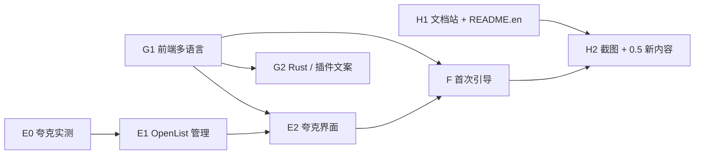

# Ludonimbus 0.5 方案（草案 v0.1 · 2026-11-23）

> **进度（2026-11-23）**
> - **E0**：已用你的夸克账号跑了两次，功能全部通过，速度数据和结论见 1.4。
> - **E1 / E2**：已完成。`crates/core/src/openlist.rs`（下载校验、启动停止、管理接口）、`cloud/quark.rs`（直接上传、读之前刷新目录）、扫码登录窗口（`app/src-tauri/src/quark_login.rs`）、设置页和引导里的夸克卡片。本机用 OpenList 本机存储跑通整条链路（`tests/openlist_local.rs`）。用真实账号跑「两台设备」检查（`./scripts/quark-e0.ps1 -TwoDevices`，`tests/quark_live.rs`）已通过；2026-11-23 你按 [testing-v0.5.md](testing-v0.5.md) 在测试版里实测（语言、首次使用引导、应用里扫码连接夸克、原有功能），没有问题。
> - **G**：已完成。前端全部文案（含示例数据）、Rust 报错 / 启动前弹窗 / 托盘 / 对话框、Steam 插件都支持中英文，设置里可以切换，立即生效。和 3.3 的差别：Rust 没有用 `rust-i18n` 查表，而是 `tr!("中文", "English")` 写在使用的地方，不会漏翻；命令行只给开发者用、不随安装包发布，暂时保留中文。说明见 [i18n.md](i18n.md)。
> - **F**：已完成，可以在浏览器预览里用 `?guide` 查看。中文界面下云盘那一步第一个推荐夸克网盘。
> - **H1**：在单独的会话里完成，2026-11-23 合并进 `main` 并上线（Pages 改为 GitHub Actions 发布，`docs/` 里的旧网页文件已删除）。
> - **H2**：截图由 `scripts/docs-screenshots.ps1` 生成；0.5 的页面和截图在分支 `docs-v0.5` 上，0.5.0 发布时合并。

> **背景**：0.4.0 正在发布。下一个版本做下面四件事；[plan-phase2.md](plan-phase2.md) 里的方向 C（同步 Steam 截图和游戏时间）顺延到 0.6。
>
> | 方向 | 一句话 |
> |---|---|
> | **E. 夸克一键连接** | Ludonimbus 自动部署 OpenList，扫码登录夸克后自动用 WebDAV 连上 |
> | **F. 首次使用引导** | 第一次打开时介绍功能、问用途，带用户配好云盘和封面 API，最后邀请去 GitHub 点 Star |
> | **G. 多语言** | 先加英文：界面、托盘、启动前弹窗、Steam 插件都能切换；README 拆出独立的英文版 |
> | **H. 文档网站** | 中英双语文档站，挂在 GitHub Pages，配步骤截图，以后持续维护 |

---

## 0. 顺序与依赖

| 步骤 | 内容 | 说明 |
|---|---|---|
| 1 | **G1** 前端多语言框架，抽出全部前端文案，翻译英文，设置里加语言选项 | 先做：E、F 的新界面直接按多语言写，不用回头再抽一遍 |
| 2 | **E0** 夸克技术验证 | 需要你的夸克账号，见 1.4。验证不通过就停下来重新评估，不往下做 E1 |
| 3 | **E1** OpenList 下载、启动、挂载夸克，新增「夸克网盘」云盘类型 | Rust 侧 |
| 4 | **G2** Rust 侧文案（错误信息、启动前弹窗、托盘、更新、命令行）和 Steam 插件 | 和 E1 都改 `cloud/`、`config.rs`，排在 E1 后面，避免两边同时改 |
| 5 | **E2** 夸克界面 | 依赖 G1、E1 |
| 6 | **F** 首次使用引导 | 云盘那一步要用到夸克，所以排在 E2 后面 |
| 7 | **H1** 文档站骨架、部署、现有功能的文档、README.en.md | **和应用代码互不影响，可以从第 1 步起并行**；用 0.4 的功能先上线，不用等 0.5 发布 |
| 8 | **H2** 截图脚本，补上夸克、引导、语言设置的文档和截图 | 等 F 完成后界面定型 |
| 9 | 测试清单 `testing-v0.5.md`、CHANGELOG、README，你实测后发布 0.5.0 | |

---

## 1. E：夸克一键连接

### 1.1 用户看到的流程

「设置 → 云盘」新增「夸克网盘（实验性）」卡片，点「连接夸克网盘」：

1. **第一次用时下载组件**：提示「夸克网盘通过开源工具 OpenList 连接，需要下载约 60 MB 的组件，来自 OpenList 的 GitHub 官方发布页」，附许可证（AGPL-3.0）和源码链接。点「下载并继续」后显示进度，下载完校验 sha256。
2. **扫码登录**：Ludonimbus 弹出一个窗口，打开夸克网盘官方网页 `pan.quark.cn`，用户用夸克 App 扫码（或用网页支持的其他方式）登录。登录成功后窗口自动关闭。
3. **自动配置**：Ludonimbus 在后台启动 OpenList（只监听本机），把夸克挂载上，在网盘里建好 `Ludonimbus` 文件夹，再用 WebDAV 连接。
4. 显示「已连接夸克网盘」。之后和其他云盘一样使用；侧边栏和设置页显示「夸克网盘」，不显示 WebDAV 地址。

登录失效时，侧边栏显示「云盘需要重新连接」（沿用现有机制），设置页给出「重新扫码登录」，只更新登录信息，不用重新下载和配置。

### 1.2 设计

**新的云盘类型 `quark`**：配置里只记文件夹名和 OpenList 版本；内部生成一个指向本机 OpenList 的 WebDAV `Store`，同步逻辑完全复用 WebDAV。单独成一种类型而不是直接存成 WebDAV，是因为：界面要显示成夸克；同步前要确保 OpenList 在运行；登录失效时走扫码而不是改密码。

**OpenList 组件**（新模块 `crates/core/src/openlist.rs`，下载部分参考 `millennium.rs`）：

| 项目 | 做法 |
|---|---|
| 版本 | **固定一个实测过的版本**（目前最新是 v4.2.10，2026-11-19），版本号和 sha256 写在代码里；发新版 Ludonimbus 时再升级。设置页可以手动「检查 OpenList 更新」，用 GitHub API 返回的 `digest` 校验 |
| 下载 | `openlist-windows-amd64.zip`（约 60 MB）。GitHub 下载失败时（国内网络常见），可以「选择已下载的 zip」，同样校验 sha256 |
| 位置 | 程序放在 `%LOCALAPPDATA%\Ludonimbus\openlist\<版本>\`，数据放在 `%APPDATA%\Ludonimbus\openlist-data\` |
| 配置 | 自己写 `config.json`：`"force": true`（否则 OpenList 优先读环境变量），`scheme.address = "127.0.0.1"`，端口挑一个空闲的并记下来，被占用时换一个 |
| 账号 | 第一次启动时设置环境变量 `OPENLIST_ADMIN_PASSWORD=<随机密码>`（4.2 起 OpenList 只在设了这个变量时才自动创建管理员，否则等网页安装向导；`admin set` 在管理员不存在时会失败），密码放 Windows 凭据管理器。另建一个 `ludonimbus` 用户，只给 WebDAV 读写权限、基础路径限定在夸克的 `Ludonimbus` 文件夹，同步只用这个用户 |
| 挂载 | `POST /api/auth/login` 取 token，`POST /api/admin/storage/create` 新建 Quark 存储（Cookie + 根目录 ID）。尽量把根目录设成 `Ludonimbus` 文件夹，OpenList 看不到网盘里的其他文件。具体字段以实测的 OpenList 版本为准（API 文档只写了登录接口）。**`cache_expiration` 必须是 0**：OpenList 默认缓存目录列表，别的设备上传的新版本会被挡住；源码里 0 表示立即过期。`webdav_policy` 用 `native_proxy`（夸克的下载地址需要带 Cookie，不能 302 给客户端） |
| 运行 | 托盘里的 Ludonimbus 启动时，如果用的是夸克，就在后台启动 OpenList（不弹窗口），退出时一起停掉。`ludonimbus-run` 同步前检查 OpenList 是否在运行，没有就自己启动、用完停掉，所以不开 Ludonimbus 从 Steam 启动游戏也能同步。启动后轮询 `/ping` 确认就绪 |
| 状态 | 定期读存储列表里的状态，Cookie 失效时标成「需要重新登录夸克」 |
| 断开 | 断开夸克时停掉 OpenList，询问是否删除组件和它的数据（里面有夸克登录信息） |

**拿到登录 Cookie**：用 Tauri 新开一个无痕窗口（Tauri 2.12 支持 `cookies_for_url`，能读到 HttpOnly Cookie），打开 `https://pan.quark.cn/`，轮询直到出现登录后的 Cookie、页面进入文件列表，再把 Cookie 交给 OpenList 并关闭窗口。无痕窗口关掉后不留登录状态，Ludonimbus 自己也不另存 Cookie（只在 OpenList 的本机数据库里）。

### 1.3 风险

| 风险 | 说明 | 应对 |
|---|---|---|
| **OpenList 不主动维护夸克驱动** | OpenList 文档原话：夸克驱动是「基于旧版产品的逆向接口」，项目组不会主动维护，也不接受修复类 issue。所以夸克改接口后，不能指望更新 OpenList 就能修好 | 标为「实验性」；固定实测过的版本；坏了也不丢存档（本机存档还在，同步失败会明确提示），可以一键把存档复制到别的云盘 |
| **上传和改名是否可用** | 驱动文档只讲了下载和预览，没写上传。Ludonimbus 的 WebDAV 先传到 `.uploading` 再用 `MOVE` 改名，夸克驱动必须支持上传、改名、建文件夹、删除 | E0 先实测，不通过就不做 |
| **速度** | 文档说夸克只能走「本地代理」，所有流量经过本机 OpenList 中转；非会员下载会限速 | 本机中转没问题；设置页像百度网盘那样提示限速 |
| **GitHub 下载慢** | 夸克用户主要在国内 | 可以手动选择已下载的 zip；文档站给出步骤 |
| **AGPL-3.0** | OpenList 是 AGPL | 不打包、不修改，用户点了才从官方发布页下载并原样运行（和 Millennium 一样）；下载提示和「关于」里写明许可证和源码地址 |
| **后台进程** | 多一个常驻进程，空闲时约几十 MB 内存；杀毒软件可能拦截新下载的程序 | 只在用夸克时运行；被拦截时给出明确提示 |
| **夸克风控** | 同步是低频请求，风险不高，但无法保证 | 文档里说明 |

### 1.4 E0：先用真实账号验证（需要你参与）

我准备好脚本和步骤，你在自己电脑上用夸克账号跑：

1. 手动下载 OpenList v4.2.10，用 1.2 的配置启动，用 Cookie 挂载夸克。
2. 用 Ludonimbus 现有的「WebDAV 测试连接」（写入、读回、删除），再跑一次完整同步：10 MB 左右的存档上传、改名、拉取、删除旧版本。
3. 记录：每一步是否成功、上传和下载速度、Cookie 多久失效、OpenList 的内存占用。

全部通过再做 E1；有一项不行（尤其是上传或改名），停下来和你重新商量。

**第一次实测结果（2026-11-23，你的夸克账号，OpenList v4.2.10，`cache_expiration = 0`）**：功能全部通过（上传、改名、覆盖写入、下载、删除、备注、设备），但很慢：

| 检查 | 耗时 |
|---|---|
| 测试连接（写入、读回、删除一个小文件） | 29.9 秒 |
| 新建多层文件夹并写入小文件 | 约 37 秒 |
| 覆盖写入小文件 | 约 32 秒 |
| 上传 10 MB | 47.2 秒（212 KB/s） |
| 下载 10 MB | 2.7 秒（3.7 MB/s） |
| 上传 3 个版本并列出 | 约 202 秒（每个版本约 67 秒） |
| 改备注 / 写两次设备信息 | 约 41 秒 / 57 秒 |
| 全部 | 475 秒，OpenList 内存约 70 MB |

整套检查一共 66 个 WebDAV 请求，平均每个约 7 秒。下载很快，慢在写入和列目录。推测主要原因是 `cache_expiration = 0`：OpenList 处理每个路径都要从根目录逐层调用夸克的列目录接口（测试路径有 5、6 层），再加上驱动每次上传完成后固定等 1 秒、建文件夹后也等 1 秒。第二次实测用 `-Compare` 对比不缓存和缓存 30 分钟两种情况，并按请求类型统计耗时。

**第二次实测（同一天，`-Compare`）**：

| 请求 | 不缓存（次数 × 平均） | 缓存 30 分钟（次数 × 平均） |
|---|---|---|
| MOVE（改名） | 13 × 22.6 秒 | 13 × 5.1 秒 |
| PUT（上传） | 15 × 9.7 秒 | 15 × 3.6 秒 |
| MKCOL（建文件夹） | 5 × 4.6 秒 | 5 × 1.7 秒 |
| DELETE | 6 × 3.1 秒 | 6 × 0.65 秒 |
| GET | 12 × 2.5 秒 | 12 × 0.63 秒 |
| PROPFIND（列目录） | 15 × 2.0 秒 | 15 × 0.06 秒 |
| 整套检查 | 547 秒 | 145 秒 |
| 10 MB 上传 / 下载 | 65 秒 / 8.8 秒 | 21 秒 / 3.9 秒 |

用 OpenList 接口强制刷新一个目录约 0.3 秒。

**结论和 E1 的做法**：
1. **开启目录缓存**（30 分钟）。OpenList 自己的写入会同步更新缓存，同一台电脑上不会读到旧数据。
2. **需要最新状态时强制刷新**：夸克云盘在 `list`、`read`、`download` 之前，先用 `/api/fs/list`（`refresh: true`）刷新对应目录，其他设备刚上传的版本也能看到，每次多约 0.3 秒。
3. **不再先传临时文件再改名**：夸克的上传本身是原子的（传完才出现在网盘里，中断不会留下半个文件），夸克这条路直接 PUT 到最终文件名，省掉缓存后仍占一半时间的 MOVE。覆盖写入由 OpenList 处理（驱动设了 `NoOverwriteUpload`，会先把旧文件改名，传完再删掉）。
4. 估算：写一个小文件约 4 秒，上传一个存档版本约 8 秒加上 zip 的传输时间（约 0.5 MB/s）；启动前检查约 1 到 2 秒。
5. **第一次两台设备实测**（2026-11-23）：读新文件、读覆盖后的内容都正确（没有读到 OpenList 缓存的旧下载链接）；覆盖写入 1.9 秒，读 1 到 2 秒，上传 1 MB 版本 12.3 秒。但 B 列不出 A 新建的 `snapshots` 文件夹：夸克驱动不能按路径直接查找，OpenList 找文件夹时用的是父目录的缓存列表，而强制刷新只刷新目标文件夹本身。已改为找不到时先刷新上一级（必要时一直往上）再重试，用模拟 OpenList 行为的单元测试覆盖；同一个目录 10 秒内只刷新一次。测试改成失败时也会清理。
6. **第三次两台设备实测（2026-11-23，通过）**：第一次往新文件夹写入时，PUT 先返回 409（上级不存在），建好文件夹后紧接着的 PUT 返回 500，2 秒后重试成功，说明夸克刚建的文件夹要过一会儿才出现在列表里。写入因此改为遇到暂时性错误时，隔 2 秒、4 秒各重试一次（读不重试）。其他耗时：覆盖写入 1.9 秒，B 读取 1 到 2 秒，上传 1 MB 版本 11.6 秒，B 列出版本 2.3 秒，下载 2.2 秒，列出没人上传过的游戏 0.3 秒。每个游戏第一次上传要多等约 10 秒（建文件夹加重试），以后可以在建文件夹后先等一会儿再上传，省掉这次 500。
7. E1 的真实账号测试要加一项**两台设备**的检查：用两个 OpenList 实例（同一个 Cookie、各自的缓存），一个写入或覆盖，另一个刷新后要能读到新内容。尤其要确认 OpenList 缓存的下载链接（30 分钟）不会让另一台设备读到旧文件。

---

## 2. F：首次使用引导

### 2.1 什么时候出现

- 没有完成过引导，**并且还没连接云盘、库里也没有游戏**时自动弹出。从 0.4 升级、已经在用的用户不会看到。
- 「设置 → 关于」里可以「重新打开新手引导」。
- 每一步都能跳过，右上角可以直接关掉；关掉也算完成，不会每次启动都弹。
- 配置里新增 `onboarding`（完成时间、选择的用途）。用途只存在本机，不上传任何地方（开发者没有服务器）。

### 2.2 步骤

| # | 页面 | 内容 |
|---|---|---|
| 1 | **欢迎** | Logo、一句话介绍、三个要点（启动前拉取、退出后上传；版本历史；存档在你自己的云盘）。右上角是**语言切换**（第一屏就要能换，系统语言和用户习惯不一致时用得上） |
| 2 | **你想用来做什么？**（可多选） | 模拟器游戏（Dolphin、Ryujinx、PCSX2…）· 重编译 / 移植游戏（Ship of Harkinian、Zelda 64: Recompiled…）· 给 Steam 里的第三方游戏加云存档 · 在多台设备之间同步存档。选择会影响后面的推荐，见 2.3 |
| 3 | **连接云盘** | 按界面语言推荐：中文推荐夸克网盘（一键）、坚果云、Google Drive，「更多」里是 NAS / WebDAV、S3、文件夹（百度网盘审核通过后加进推荐）；英文推荐 Google Drive、WebDAV（NAS / Nextcloud）、S3、同步文件夹（OneDrive / Dropbox）。直接复用设置页的云盘表单，连接成功后自动进入下一步 |
| 4 | **封面（SteamGridDB API Key）** | 说明用途（加入 Steam 时自动配好封面、背景、Logo、图标）和获取步骤：打开 SteamGridDB 用 Steam 账号登录 → 偏好设置 → API → 生成 Key → 粘贴。按钮直接打开 Key 页面。复用现有的 `SgdbKeyForm`。不填也行，可以用本地图片 |
| 5 | **完成** | 已配置的项目打勾，跳过的写「以后可以在设置里配置」；主按钮「扫描本机游戏」直接打开「添加游戏 → 扫描本机」；按用途给出下一步建议和对应文档链接；最后是「Ludonimbus 对你有帮助的话，欢迎到 GitHub 点个 Star ⭐」，按钮打开仓库页。预留 Discord 入口，链接填上之前不显示 |

### 2.3 用途怎么影响推荐

| 用途 | 影响 |
|---|---|
| 多设备同步 | 云盘那一步不推荐「本机文件夹」（除非它本身被同步）；提醒把设备名改成认得出的名字（如「客厅主机」「掌机」） |
| 模拟器 | 完成页说明「按游戏同步」和「整个模拟器同步」的区别，链接模拟器文档 |
| 重编译游戏 | 完成页说明能自动认出 140 多个重编译游戏、RecompLauncher 装的游戏会直接列出 |
| Steam 第三方游戏 | 完成页推荐「在 Steam 中显示云存档状态」和「一键加入 Steam」 |

GitHub、文档、反馈的链接同时常驻在「设置 → 关于」。

---

## 3. G：多语言

### 3.1 范围

| 部分 | 现状（含中文的行数，约） | 做法 |
|---|---|---|
| 前端界面 | 约 570 行，20 个文件 | 3.2 |
| Rust 错误信息（会显示在界面上） | 约 250 行，主要在 `cloud/`、`games.rs`、`millennium.rs`、`steam.rs` | 3.3 |
| 启动前弹窗（冲突、游戏位置变了） | `crates/runner`，16 行 | 3.3 |
| 托盘菜单、更新、Steam 插件安装 | `app/src-tauri`，约 40 行 | 3.3 |
| 命令行 | `crates/cli`，43 行 | 3.3 |
| Steam 插件 | `plugin-millennium`，约 40 行 | 本机接口返回当前语言，插件内置两套文案 |
| 规则文件里显示给用户的字段 | `emulators.yaml` 的 `platform`（如「Switch 模拟器」） | 改成和语言无关的写法（如 `Switch`），「模拟器」由界面补上；注释保持中文 |
| 安装程序 | 已经有简体中文和英文 | 不变 |
| 更新提示 | 显示 CHANGELOG 的中英两段 | 只显示当前语言那一段 |
| 日志 | 中文 | 不翻译（只用于排查问题） |

**语言选择**：默认跟随 Windows 显示语言（`zh-*` 用简体中文，其他用英文）；「设置 → 通用 → 语言」可选「跟随系统 / 简体中文 / English」。存在配置里，界面、托盘、启动前弹窗、Steam 插件、命令行都读同一个设置。

### 3.2 前端

- **不加依赖**：`app/src/i18n/zh-CN.ts` 是原文，`en.ts` 的类型就是 `typeof zhCN`，少一个词条 `tsc` 就报错，CI 能拦住。带参数的文案写成函数（`connected: (name) => …`），英文单复数在函数里处理。
- `useI18n()` 返回当前语言的文案和切换函数；`format.ts` 这类非组件代码通过模块级的取值函数拿当前文案。日期、大小用 `Intl` 按当前语言格式化。
- 浏览器预览用的 `mock.ts` 也按语言提供示例数据（游戏名、备注），英文截图里不会出现中文。
- 英文版界面更长，要在最小窗口（980×620）下检查按钮和侧边栏。
- 新增 `docs/i18n.md`：术语表（存档 save、云盘 cloud、版本 version、自动同步 auto-sync、快捷方式 shortcut、冲突 conflict…，尽量和 Steam 英文界面一致）和以后加新语言的步骤。

### 3.3 Rust 侧

- `ludonimbus-core` 新增 `i18n` 模块：文案放在 `crates/core/locales/zh-CN.yaml`、`en.yaml`，编译时嵌入；全局语言在启动时从配置读取。倾向用 `rust-i18n` crate（`t!("key", name = …)`），实现时如果发现它和现有错误处理配合不好，就改成自己写的小模块。
- 加一个测试检查两种语言的词条完全一致。
- `ludonimbus-run` 的弹窗、托盘菜单、命令行都用同一套文案。

### 3.4 README

- `README.md` 保持中文，顶部导航的「English」改为链接到新的 `README.en.md`，删掉底部的英文段落。
- `README.en.md` 是完整的英文版，结构和中文版一致，顶部链回「简体中文」。
- 两份都在顶部加文档站链接。

---

## 4. H：文档网站

### 4.1 技术与部署

- **VitePress**：Markdown 写作，自带多语言、站内搜索、深色模式，生成纯静态文件。放在新目录 `website/`，有自己的 `package.json`，和应用互不影响。
- `docs/` 继续放开发者文档（方案、测试清单、发版流程），不发布到网站。
- **网址不变**：`https://shupian0510.github.io/Ludonimbus/`。**`privacy.html` 必须保持原地址**：Google OAuth 同意屏幕和百度开放平台审核都填了这个链接。
- 新增 `.github/workflows/docs.yml`：`website/` 有改动时构建并部署到 GitHub Pages。
- **需要你操作一次**：仓库「Settings → Pages → Source」从「Deploy from a branch（main /docs）」改成「GitHub Actions」（也可以让我用 `gh` 改，需要你同意）。切换并确认新站正常后，再删掉 `docs/index.html`、`docs/privacy.html`、`docs/.nojekyll`、`docs/app-icon.svg`。
- **语言**：`/` 是简体中文，`/en/` 是英文，顶部可以切换。应用里的「帮助」链接按界面语言打开对应页面。中文搜索用 `Intl.Segmenter` 分词。

### 4.2 内容结构（中英相同）

| 分组 | 页面 |
|---|---|
| 首页 | 一句话介绍、功能、截图、下载按钮 |
| 入门 | Ludonimbus 是什么 / 工作原理 · 安装（含「未知发布者」提示）· 首次使用引导 · 快速上手（连接云盘 → 添加游戏 → 开启 Steam 自动同步 → 照常玩） |
| 云盘 | 怎么选（对比表）· 夸克网盘 · Google Drive · 百度网盘（开放后）· WebDAV（坚果云、群晖、威联通、Nextcloud、OpenList）· S3（MinIO、阿里云 OSS、腾讯云 COS、Cloudflare R2）· 文件夹 · 换云盘与复制存档 |
| 添加游戏 | 扫描本机 · 找存档向导（玩一下再找）· 扫描文件夹 · 手动添加 · 游戏位置变了怎么办 |
| Steam | 开启 Steam 自动同步 · 一键加入 Steam · 封面与 SteamGridDB · 在 Steam 里显示云存档状态 |
| 同步与存档 | 同步怎样工作 · 版本历史（恢复、导出、锁定、备注、自动清理）· 冲突 · 离线 · 多台设备 |
| 支持的游戏 | 模拟器（每个模拟器：按游戏还是整体同步、存档在哪、注意事项）· 重编译 / 移植游戏 · 普通 PC 游戏（Ludusavi） |
| 参考 | 设置项说明 · 常见问题与故障排查（日志位置、常见错误）· 隐私政策 · 更新日志（构建时从 CHANGELOG.md 按语言生成）· 参与贡献（存档规则、翻译） |

### 4.3 截图

- **能自动生成的**：前端可以在浏览器里用示例数据运行（`npm run dev`）。示例数据模式下加一个 `?scene=…&lang=…` 参数，直接打开某个页面或弹窗；新增 `scripts/docs-screenshots.ps1`，启动 Vite，用 Windows 11 自带的 Edge 无头模式按「场景 × 语言」截图到 `website/public/screenshots/<语言>/`。界面改了重跑一次，截图就跟上了，不用手工维护。
- **需要你提供的**（真实环境，示例数据做不出来）：Steam 游戏页的云存档状态栏、加了封面的 Steam 库、夸克扫码登录页、SteamGridDB 的 API Key 页面、Windows「未知发布者」提示。每张我会写清楚要截哪里、用什么语言。

### 4.4 以后怎么维护

- 改了用户能看到的功能时，同一个 PR 里更新文档（写进 `docs/development.md` 的检查清单）。
- 文档站不跟应用版本走，`main` 上改了就部署。0.5 新功能的页面在 0.5.0 发布时再合并上线。

---

## 5. 默认做法（有不同意见可以改）

- 引导只给新用户自动弹出，老用户在设置里可以打开。
- 语言默认跟随系统；文档站根路径是中文，英文在 `/en/`。
- 夸克标为「实验性」，OpenList 固定版本，不自动升级。
- 文档站用 VitePress，放 `website/`。
- 0.5 不做截图和游戏时间同步（顺延到 0.6）。

## 6. 需要你做的事

| 时间 | 事情 |
|---|---|
| E0 | 用你的夸克账号跑一遍验证（我准备好步骤和脚本） |
| H1 上线前 | 把 GitHub Pages 的来源改成 GitHub Actions（或同意我用 `gh` 改） |
| H2 | 按清单补几张真实环境的截图 |
| 发布前 | 按 `testing-v0.5.md` 实测 |
| 以后 | 有 Discord 频道时把链接给我，引导完成页和文档站会加上 |
